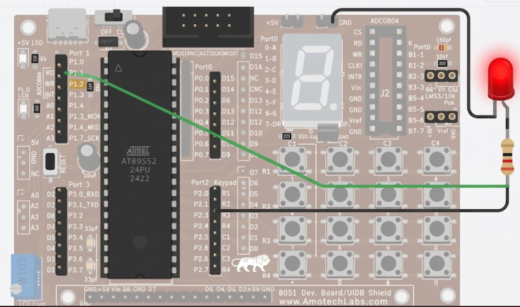

# EXPERIMENT DETAILS

* **Experiment:** Continuous Assessment 1 (CAT 1)
* **Date:** 
* **Name of Experiment:** 8051 Development Board Tool Chain Setup
* **Hardware Setup / Platform:** 8051 Microcontroller + Keil µVision

---

## TASK 2A : Bare-Metal LED Blink

### 1. Circuit Diagram & Hardware Description
The experiment demonstrates LED blinking using an 8051 microcontroller.
* **Microcontroller:** 8051
* **GPIO Port:** Port 1
* **GPIO Pin:** P1.1 (Configured via code base)
* **Peripheral:** LED with current-limiting resistor
* **Power Supply:** 5V DC
## Circuit Diagram

---

### 2. Core Logic / Pseudocode / Code Base

**Working Principle:**

The LED is connected to pin P1.1 of the 8051 microcontroller. The microcontroller continuously switches the pin between HIGH and LOW states, creating a blinking effect.

A software delay function is used to introduce time intervals between the LED transitions.

**Pseudocode:**

1. Include the 8051 register definition header file (`reg51.h`).
2. Define P1.1 as the LED control pin (`led1`).
3. Create a delay function using nested loops.
4. Turn the LED ON by setting P1.1 HIGH (`1`).
5. Call the delay function.
6. Turn the LED OFF by setting P1.1 LOW (`0`).
7. Call the delay function again.
8. Repeat continuously.

**Code Base:**

The program is written in Embedded C using Keil C51.

- `reg51.h` provides the 8051 register definitions.
- `sbit led1 = P1^1` assigns the LED to pin P1.1.
- `led1 = 1` sets the pin HIGH and turns the LED ON.
- `led1 = 0` sets the pin LOW and turns the LED OFF.
- `delay()` uses nested loops to generate a software delay.
- `while(1)` ensures that the LED blinking operation continues indefinitely.

---
### 3. Inference 
Execution Behavior: The LED connected to pin P1.1 blinks continuously as the microcontroller alternates between HIGH and LOW output states based on the nested software delay loops.

Technical Learning Outcomes: This experiment successfully demonstrates GPIO output control, software delay generation, and foundational Embedded C programming utilizing the 8051 toolchain ecosystem and custom startup configurations.
