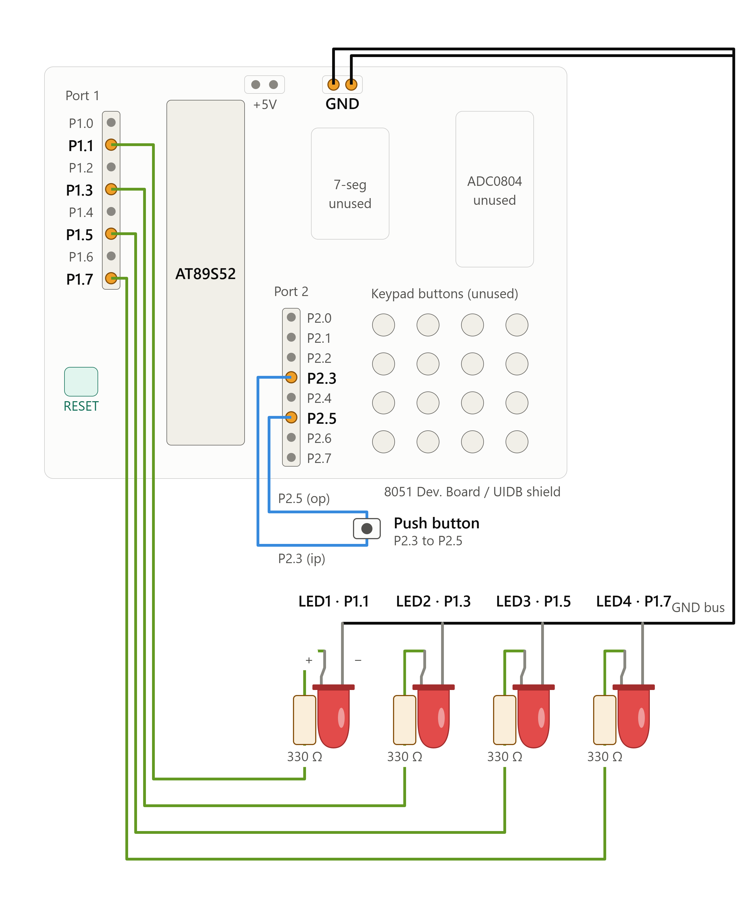

# EXPERIMENT DETAILS

- **Experiment:** Continuous Assessment 3 (CAT 3)
- **Date:**
- **Name of Experiment:** Four-State LED Pattern Generator with Push-Button Debouncing
- **Hardware Setup / Platform:** AT89S52 Microcontroller + Keil µVision (Bare-Metal Embedded C)

---

## TASK 3A: Four-State LED Control System with Button Debouncing

### 1. Circuit Diagram & Hardware Description

The experiment implements a GPIO-based LED controller that manages four LEDs and a push-button input to switch between four different LED operating patterns.

- **Microcontroller:** AT89S52 (8051)
- **GPIO Outputs:** Four LEDs connected to Port 1 pins P1.0 to P1.3.
- **GPIO Input:** One push-button connected to P3.2 (INT0-capable pin), configured for active-low polling.
- **Hardware Debug Tools:** Multimeter for pin and voltage verification.
- **Power Supply:** 5V DC regulated.

## Circuit Diagram

---

### 2. Core Logic / Pseudocode / Code Base

#### Working Principle

The system operates as a four-state finite state machine (FSM), where each valid push-button press changes the current LED operating mode.

1. **Button Debouncing:** Software-based debouncing prevents multiple mode changes caused by mechanical bouncing of the push-button contacts.
2. **State 1 – Running LED:** LEDs turn ON sequentially in the order LED1 → LED2 → LED3 → LED4, and the sequence repeats.
3. **State 2 – Binary Counter:** The four LEDs display an incrementing binary count from `0000` to `1111`.
4. **State 3 – Alternating Pattern:** LEDs alternate between the patterns `1010` and `0101`.
5. **State 4 – All LED Flash:** All four LEDs flash simultaneously between `1111` (ON) and `0000` (OFF).

#### Pseudocode

1. Include the 8051 register definition header file (`reg51.h`).
2. Define four LED output pins on Port 1 and the push-button input pin on P3.2.
3. Initialize the LED output port and set the initial operating mode to 1.
4. Continuously monitor the push-button input.
5. When a button press is detected:
   - Introduce a short software delay to eliminate contact bouncing.
   - Verify that the button is still pressed.
   - Increment the operating mode.
   - Reset the mode to 1 if it exceeds 4.
   - Wait until the button is released.
6. Execute the LED pattern corresponding to the current operating mode.
7. Repeat the process continuously.

#### Code Base

The program is developed using Embedded C in Keil µVision for the AT89S52 microcontroller. The `reg51.h` header file provides access to the 8051 hardware registers.

- Four LED pins (P1.0–P1.3) are configured as output pins, and the push-button is connected to P3.2 as an input.
- A software delay function is implemented to generate timing intervals and debounce the push-button.
- A variable named `mode` maintains the current operating state, initially set to 1.
- A button press is detected by checking whether the input pin goes LOW. After a debounce delay, the input is checked again to confirm a valid press.
- The operating mode is incremented after each valid press. Once the mode exceeds 4, it resets to 1.
- A `switch-case` control structure executes the corresponding LED pattern based on the current mode.

**LED Operating Patterns:**

1. **Mode 1 – Running LED:** LEDs turn ON one at a time in sequence: LED1 → LED2 → LED3 → LED4. After LED4, the sequence repeats from LED1.
2. **Mode 2 – Binary Counter:** The four LEDs display a 4-bit binary count, starting from `0000` and incrementing up to `1111`. The sequence then restarts from `0000`.
3. **Mode 3 – Alternating Pattern:** The LEDs alternate between `1010` and `0101`, switching the ON and OFF positions after each delay.
4. **Mode 4 – All LED Flash:** All four LEDs turn ON simultaneously (`1111`) and then turn OFF simultaneously (`0000`). This cycle repeats continuously.

- Bitwise operations are used to generate binary and alternating patterns while preserving the upper four bits of Port 1.
- The program continuously executes the selected LED pattern and checks for further button presses to switch between operating modes.

---

### 3. Inference

1. **Execution Behavior:** The system demonstrates four distinct LED operating modes: Running LED, Binary Counter, Alternating Pattern, and All-LED Flash. The push-button allows the user to switch between these modes sequentially.
2. **Technical Learning Outcomes:** The experiment demonstrates direct GPIO register-level programming on the AT89S52 microcontroller, software-based button debouncing, bitwise operations, and finite state machine implementation using Embedded C.