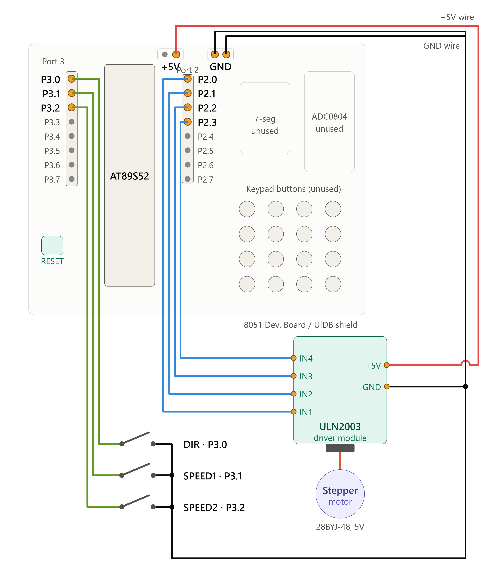

# EXPERIMENT DETAILS

- **Experiment:** Continuous Assessment 5 (CAT 5)
- **Date:**
- **Name of Experiment:** Stepper Motor Control Using Timer 0 Interrupts with Variable Speed and Direction
- **Hardware Setup / Platform:** AT89S52 Microcontroller + Keil µVision (Bare-Metal Embedded C)
- **Crystal Frequency:** 11.0592 MHz

---

## TASK 5C: Stepper Motor Control Using Timer Interrupts

### 1. Circuit Diagram & Hardware Description

The experiment implements a stepper motor control system using Timer 0 interrupts of the AT89S52 microcontroller. The motor is controlled by generating a sequence of digital output patterns through Port 2. Two input switches are used to select the motor speed, while another input controls the direction of rotation.

- **Microcontroller:** AT89S52 (8051)
- **Timer Used:** Timer 0
- **Timer Mode:** Mode 1 (16-bit Timer Mode)
- **Clock Frequency:** 11.0592 MHz crystal oscillator.
- **Timer Initial Value:** `0xFC66`.
- **Motor Output:** Port 2 (P2) connected to the stepper motor driver.
- **Motor Control Pins:** P2.0–P2.3 used for the four-step output sequence.
- **Direction Control:** P3.0.
- **Speed Selection Inputs:** P3.1 and P3.2.
- **Power Supply:** 5V DC regulated for the microcontroller, with an appropriate motor supply.
- **Development Environment:** Keil µVision using Embedded C (Keil C51).

## Circuit Diagram

---

### 2. Core Logic / Pseudocode / Code Base

#### Working Principle

The system controls a stepper motor by generating a predefined sequence of digital output patterns. Timer 0 is configured to generate periodic interrupts, which are used to maintain the motor stepping interval.

The motor speed is controlled by changing the number of timer interrupts between consecutive steps. Two input pins select between three speed levels, while a separate input pin determines the direction of rotation.

1. **Timer Configuration:** The TMOD register is configured with `0x01` to operate Timer 0 in Mode 1 (16-bit mode).
2. **Timer Initialization:** TH0 and TL0 are loaded with `0xFC` and `0x66`, respectively, to generate approximately 1 ms timer intervals.
3. **Interrupt Configuration:** The ET0 and EA bits are enabled to activate Timer 0 interrupts and global interrupts.
4. **Timer Interrupt:** The Timer 0 interrupt service routine reloads the timer registers and increments a software counter.
5. **Step Timing:** When the counter reaches the selected `step_delay` value, the counter resets and a flag named `step_due` is set.
6. **Motor Speed Selection:** Two input pins (P3.1 and P3.2) determine the delay between consecutive motor steps:
   - Slow: 100 ms per step.
   - Medium: 50 ms per step.
   - Fast: 10 ms per step.
7. **Step Sequence:** A predefined array stores four output patterns: `1000`, `0100`, `0010`, and `0001`.
8. **Direction Control:** The direction input determines whether the step index increases or decreases through the sequence.
9. **Motor Output:** When `step_due` becomes 1, the corresponding pattern is sent to Port 2 to generate the next motor step.
10. **Continuous Operation:** The process repeats continuously, allowing the motor to rotate at the selected speed and direction.

#### Motor Step Sequence

The program uses a four-element array named `step_pattern` to store the output sequence.

| Step | Hexadecimal Pattern | Binary Pattern |
|:---:|:---:|:---:|
| 1 | `0x08` | `1000` |
| 2 | `0x04` | `0100` |
| 3 | `0x02` | `0010` |
| 4 | `0x01` | `0001` |

**Forward Direction (direction = 0):**

The step index is incremented after each step.

`1000 → 0100 → 0010 → 0001 → 1000`

**Reverse Direction (direction = 1):**

The step index is decremented after each step.

`1000 → 0001 → 0010 → 0100 → 1000`

After reaching the beginning or end of the sequence, the pattern repeats continuously.

#### Speed Selection Table

The speed is selected using two input pins, P3.1 and P3.2.

| P3.1 | P3.2 | Speed Mode | Step Delay |
|:---:|:---:|:---:|:---:|
| 1 | 1 | Slow | 100 ms |
| 1 | 0 | Medium | 50 ms |
| 0 | 1 | Fast | 10 ms |
| 0 | 0 | Fast | 10 ms |

The program selects the speed by checking the logic levels of the two input pins.

#### Timer Calculation

**Given:**

- Crystal Frequency = 11.0592 MHz
- Timer Mode = 1 (16-bit)
- Timer Initial Value = `0xFC66` = 64614

**Machine Cycle Duration:**

\[
T_{machine}=\frac{12}{11.0592\times10^6}
\]

\[
T_{machine}\approx1.085\ \mu s
\]

**Number of Timer Counts:**

\[
N=65536-64614
\]

\[
N=922
\]

**Timer Overflow Duration:**

\[
T=922\times1.085\ \mu s
\]

\[
T\approx1\ ms
\]

Therefore, Timer 0 generates approximately one interrupt every 1 ms.

**Motor Step Intervals:**

- **Slow Mode:**

\[
100\times1\ ms=100\ ms/step
\]

- **Medium Mode:**

\[
50\times1\ ms=50\ ms/step
\]

- **Fast Mode:**

\[
10\times1\ ms=10\ ms/step
\]

The motor speed increases as the delay between consecutive steps decreases.

#### Pseudocode

1. Include the 8051 register definition header file (`reg51.h`).
2. Define the direction input pin as P3.0.
3. Define the two speed selection input pins as P3.1 and P3.2.
4. Initialize the following variables:
   - `step_index = 0` to track the current motor step.
   - `step_delay = 100` to set the initial stepping interval.
   - `count = 0` to count timer interrupts.
   - `step_due = 0` to indicate when the next motor step should be generated.
5. Initialize the four-element step pattern array with the required output sequences.
6. Configure Timer 0 in Mode 1 using the TMOD register.
7. Load TH0 and TL0 with `0xFC66`.
8. Initialize Port 2 and enable Timer 0 and global interrupts using ET0 and EA.
9. Start Timer 0 by setting TR0 to 1.
10. Inside the Timer 0 interrupt service routine:
    - Reload TH0 and TL0.
    - Increment the software counter.
    - Check whether the counter has reached the selected step delay.
    - If the condition is satisfied, reset the counter and set `step_due` to 1.
11. Inside the main infinite loop:
    - Check the speed selection inputs.
    - Set `step_delay` to 100, 50, or 10 depending on the selected speed.
    - Check whether `step_due` is set.
12. When `step_due` becomes 1:
    - Clear the flag.
    - Send the current step pattern to Port 2.
    - Check the direction input.
    - Increment the step index for forward rotation.
    - Decrement the step index for reverse rotation.
    - Wrap the index around when it reaches the sequence limits.
13. Repeat continuously to control motor speed and direction.

#### Code Base

The program is developed using Embedded C in Keil µVision for the AT89S52 microcontroller. The `reg51.h` header file provides access to the 8051 hardware registers and interrupt functionality.

- Three input pins are defined using `sbit` declarations: P3.0 for direction control and P3.1 and P3.2 for speed selection.
- The variable `step_index` maintains the current position in the motor stepping sequence.
- The variable `step_delay` determines the number of timer interrupts between consecutive motor steps.
- The variable `count` maintains the number of Timer 0 interrupts received.
- The variable `step_due` acts as a flag to indicate when the next motor step must be generated.
- The `step_pattern[4]` array stores the four output patterns: `0x08`, `0x04`, `0x02`, and `0x01`.
- The Timer 0 interrupt service routine (`timer0_isr`) is declared using the `interrupt 1` keyword.
- Inside the interrupt service routine, TH0 and TL0 are reloaded with `0xFC` and `0x66` to maintain an approximately 1 ms timer interval.
- The interrupt counter is incremented after every timer overflow. When it reaches the selected `step_delay`, it resets to zero and sets `step_due` to 1.
- The TMOD register is configured with `0x01` to select Timer 0 in 16-bit Mode 1.
- The ET0 bit enables Timer 0 interrupts, while EA enables global interrupts. The TR0 bit starts the timer.
- The `main()` function continuously monitors the speed selection inputs and updates `step_delay` according to the selected speed.
- When `step_due` becomes 1, the corresponding pattern from the step array is sent to Port 2.
- The direction input determines whether `step_index` is incremented or decremented. Boundary checks ensure that the sequence repeats continuously without exceeding the array limits.
- The complete implementation uses timer interrupts for step timing and the main loop for motor speed selection and output sequence control.

---

### 3. Inference

**Execution Behavior:** Timer 0 is configured in 16-bit Mode 1 and generates periodic interrupts of approximately 1 ms. These interrupts are used to control the interval between consecutive motor steps. The stepper motor output sequence changes according to the selected speed and direction inputs.

**Speed Control:** The system provides three speed levels: Slow (100 ms/step), Medium (50 ms/step), and Fast (10 ms/step). Reducing the delay between consecutive steps increases the motor stepping rate.

**Direction Control:** The direction input allows the motor stepping sequence to operate in forward or reverse order by incrementing or decrementing the step index.

**Technical Learning Outcomes:** The experiment demonstrates Timer 0 interrupt configuration, interrupt service routine implementation, software counters, flag-based communication between interrupt and main program, GPIO interfacing, array-based step sequencing, and variable-speed motor control using Embedded C on the AT89S52 microcontroller.