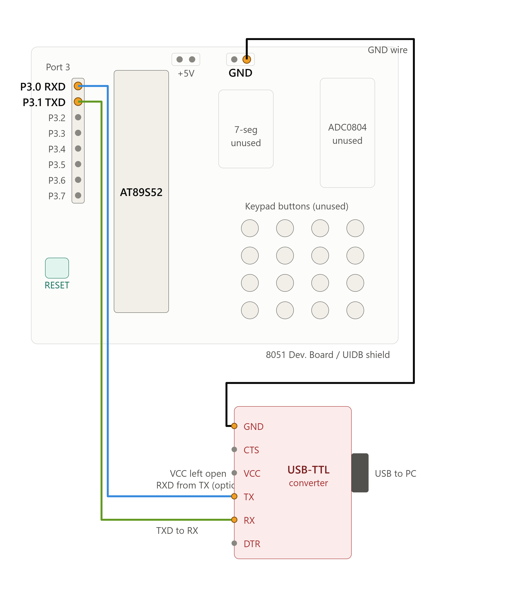

# EXPERIMENT DETAILS

- **Experiment:** Continuous Assessment 6 (CAT 6)
- **Date:**
- **Name of Experiment:** UART Echo – Character Reception and Transmission Using 8051
- **Hardware Setup / Platform:** AT89S52 Microcontroller + Keil µVision (Bare-Metal Embedded C)
- **Crystal Frequency:** 11.0592 MHz
- **Communication Interface:** USB-to-TTL Serial Converter
- **Terminal Software:** PuTTY

---

## TASK 6B: UART Echo

### 1. Circuit Diagram & Hardware Description

The experiment implements two-way serial communication between the AT89S52 microcontroller and a PC terminal using the built-in UART peripheral.

The microcontroller receives characters typed by the user in PuTTY through the RXD pin and immediately transmits the same characters back through the TXD pin. This creates an interactive UART echo system.

- **Microcontroller:** AT89S52 (8051)
- **Communication Peripheral:** UART
- **UART Mode:** Mode 1 (8-bit UART)
- **Communication Type:** Asynchronous Serial Communication
- **Baud Rate:** 9600 bps
- **Data Bits:** 8 bits
- **Stop Bits:** 1
- **Parity:** None
- **UART Receive Pin:** RXD (P3.0)
- **UART Transmit Pin:** TXD (P3.1)
- **Timer Used:** Timer 1
- **Timer Mode:** Mode 2 (8-bit Auto-Reload)
- **Timer Reload Value:** `0xFD`
- **Serial Control Register:** `SCON = 0x50`
- **Serial Communication Interface:** USB-to-TTL Converter
- **PC Terminal:** PuTTY
- **Development Environment:** Keil µVision using Embedded C (Keil C51).

## Circuit Diagram

---

### 2. Core Logic / Pseudocode / Code Base

#### Working Principle

The program configures the UART peripheral for asynchronous serial communication at 9600 baud and implements a character-by-character echo mechanism.

Whenever a character is typed in PuTTY, the 8051 receives it through the UART receiver. The received character is temporarily stored in a variable and then transmitted back to the PC terminal using the UART transmitter.

1. **Timer Configuration:** The TMOD register is assigned `0x20` to configure Timer 1 in Mode 2 (8-bit auto-reload mode).
2. **Baud Rate Configuration:** The TH1 register is loaded with `0xFD` to generate a baud rate of 9600 bps.
3. **UART Configuration:** The SCON register is assigned `0x50` to select UART Mode 1 and enable serial reception.
4. **Timer Activation:** The TR1 bit is set to 1 to start Timer 1.
5. **Flag Initialization:** The TI and RI flags are cleared before starting communication.
6. **Character Reception:** The program continuously monitors the RI (Receive Interrupt) flag. When RI becomes 1, it indicates that a character has been received.
7. **Data Retrieval:** The received character is read from the SBUF register and stored in the variable `ch`.
8. **Receive Flag Reset:** The RI flag is cleared to prepare for the next received character.
9. **Character Transmission:** The received character is loaded back into the SBUF register, initiating transmission through the TXD pin.
10. **Transmission Monitoring:** The program waits until the TI flag becomes 1, indicating that transmission is complete.
11. **Transmit Flag Reset:** The TI flag is cleared to prepare for the next transmission.
12. **Continuous Operation:** The process repeats indefinitely, allowing every received character to be echoed back to PuTTY.

#### UART Configuration

| Parameter | Configuration |
|---|---|
| UART Mode | Mode 1 |
| Communication | Asynchronous |
| Data Bits | 8 |
| Baud Rate | 9600 bps |
| Stop Bits | 1 |
| Parity | None |
| Timer | Timer 1 |
| Timer Mode | Mode 2 |
| TH1 Value | `0xFD` |
| SCON Value | `0x50` |
| Receive Flag | RI |
| Transmit Flag | TI |
| Data Register | SBUF |

#### Timer and Baud Rate Calculation

**Given:**

- Crystal Frequency = 11.0592 MHz
- Timer 1 Mode = 2 (8-bit Auto-Reload)
- TH1 = `0xFD`
- SMOD = 0

**Timer Reload Value:**

\[
TH1=0xFD=253
\]

**Number of Timer Counts:**

\[
N=256-253
\]

\[
N=3
\]

**Baud Rate Calculation:**

For UART Mode 1 with Timer 1 operating in Mode 2:

\[
Baud\ Rate=
\frac{2^{SMOD}}{32}
\times
\frac{f_{osc}}{12(256-TH1)}
\]

Since SMOD = 0:

\[
Baud\ Rate=
\frac{11.0592\times10^6}{32\times12\times3}
\]

\[
\boxed{Baud\ Rate=9600\ bps}
\]

Therefore, Timer 1 generates the required baud rate of 9600 bps for UART communication.

#### UART Echo Operation

The following sequence describes the character echo process.

**Example:**

- User types: `ABC123`
- 8051 receives: `A`
- 8051 transmits: `A`
- 8051 receives: `B`
- 8051 transmits: `B`
- 8051 receives: `C`
- 8051 transmits: `C`
- The process continues until all characters are echoed.

**Expected PuTTY Output:**

```text
ABC123
```

#### Pseudocode

1. Include the 8051 register definition header file (`reg51.h`).
2. Define the UART initialization function `uart_init()`.
3. Configure Timer 1 in Mode 2 using `TMOD = 0x20`.
4. Load TH1 with `0xFD` for 9600 baud rate generation.
5. Configure UART Mode 1 using `SCON = 0x50`.
6. Start Timer 1 by setting `TR1 = 1`.
7. Clear the TI and RI flags.
8. Call the UART initialization function from the main function.
9. Declare a character variable `ch` to temporarily store received data.
10. Enter an infinite loop:
    - Wait until RI becomes 1.
    - Read the received character from SBUF.
    - Store the character in `ch`.
    - Clear RI.
    - Load the received character into SBUF to transmit it back.
    - Wait until TI becomes 1.
    - Clear TI.
11. Repeat the process continuously to implement character echoing.

#### Code Base

The program is developed using Embedded C in Keil µVision for the AT89S52 microcontroller. The `reg51.h` header file provides access to the UART and timer hardware registers.

- The `uart_init()` function initializes the UART peripheral and configures Timer 1 for baud rate generation.
- The TMOD register is assigned `0x20` to configure Timer 1 in Mode 2 (8-bit auto-reload mode).
- The TH1 register is loaded with `0xFD` to generate a baud rate of 9600 bps.
- The SCON register is assigned `0x50` to configure UART Mode 1 and enable serial reception.
- The TR1 bit is set to 1 to start Timer 1.
- The TI and RI flags are initialized to zero.
- In the `main()` function, a character variable `ch` is declared to store the received character.
- The program continuously checks the RI flag using a polling loop.
- When RI becomes 1, the received character is retrieved from the SBUF register and stored in `ch`.
- The RI flag is cleared after retrieving the received character.
- The stored character is loaded back into SBUF to initiate transmission.
- The program waits for the TI flag to indicate transmission completion.
- After transmission, TI is cleared to prepare for the next character.
- This process repeats continuously, enabling interactive character-by-character UART communication between the 8051 and the PC terminal.

---

### 3. Inference

**Execution Behavior:** The UART peripheral is configured for asynchronous serial communication at 9600 baud. The microcontroller receives characters from the PC terminal and transmits the same characters back, implementing a basic UART echo system.

**Reception Mechanism:** The RI flag is monitored to identify incoming characters. The received data is retrieved from the SBUF register and stored temporarily before transmission.

**Transmission Mechanism:** The TI flag is used to identify the completion of each transmitted character. Clearing the flag allows the next character to be transmitted.

**Interactive Communication:** The experiment demonstrates two-way serial communication between the 8051 microcontroller and PuTTY through a USB-to-TTL serial interface.

**Technical Learning Outcomes:** Successfully implemented UART initialization, serial data reception, serial data transmission, baud rate configuration, SBUF register operations, RI and TI flag monitoring, and polling-based character echoing using Embedded C on the AT89S52 microcontroller.