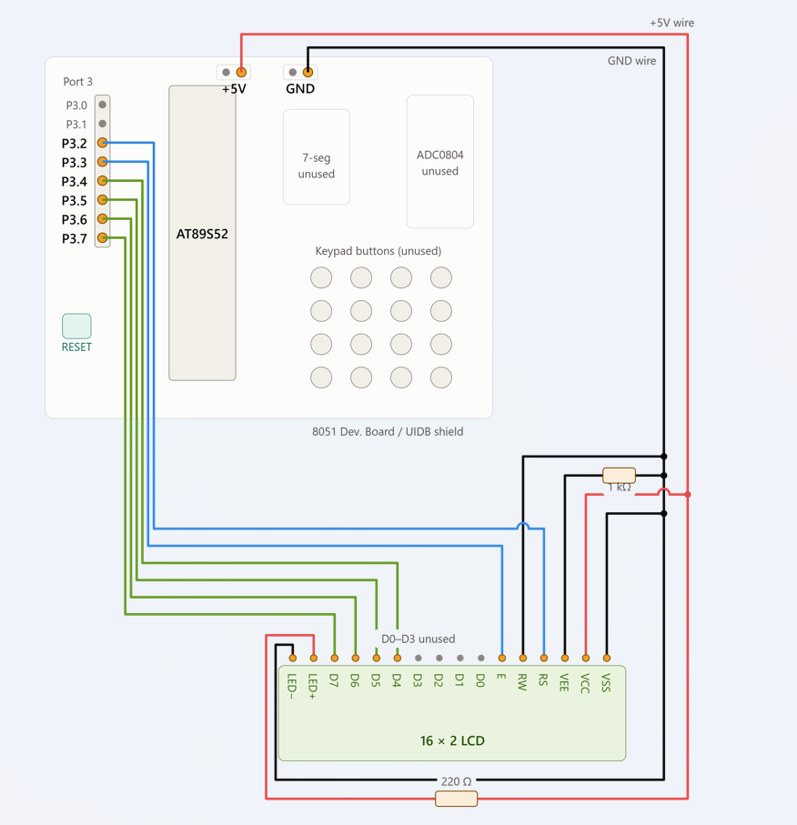

# EXPERIMENT DETAILS

- **Experiment:** Continuous Assessment 7 (CAT 7)
- **Date:**
- **Name of Experiment:** LCD Initialization and Character/String Display Using 8051
- **Hardware Setup / Platform:** AT89S52 Microcontroller + 16×2 LCD + Keil µVision (Bare-Metal Embedded C)
- **Crystal Frequency:** 11.0592 MHz
- **Display Interface:** HD44780-Compatible 16×2 Character LCD
- **Communication Mode:** 4-bit GPIO-Based Interface
- **Development Environment:** Keil µVision using Embedded C (Keil C51).

---

## TASK 7A: LCD Initialization and Character/String Display

### 1. Circuit Diagram & Hardware Description

The experiment implements a 4-bit GPIO-based LCD driver using the AT89S52 microcontroller. The 16×2 character LCD is initialized in 4-bit, 2-line mode using an HD44780-compatible command sequence. The microcontroller sends commands and character data to the LCD through GPIO pins to display individual characters and strings on both rows.

- **Microcontroller:** AT89S52 (8051)
- **Display Device:** 16×2 Character LCD
- **LCD Controller:** HD44780-Compatible
- **Communication Interface:** GPIO
- **Communication Mode:** 4-bit Mode
- **Display Configuration:** 2 Lines × 16 Characters
- **Register Select Pin (RS):** P3.2
- **Enable Pin (EN):** P3.3
- **LCD Data Pins (D4–D7):** P3.4–P3.7
- **Read/Write Pin (RW):** Ground (Write Mode)
- **LCD Power Supply:** 5V
- **Development Environment:** Keil µVision using Embedded C (Keil C51).

## Circuit Diagram

### 2. Core Logic / Pseudocode / Code Base

#### Working Principle

The program configures the 16×2 LCD to operate in 4-bit communication mode. Instead of transmitting an entire 8-bit command or character at once, the microcontroller sends the upper four bits followed by the lower four bits.

The RS pin determines whether the transmitted information is a command or character data. The EN pin generates an enable pulse to transfer each 4-bit portion to the LCD.

1. **GPIO Configuration:** The RS and EN control pins are assigned to P3.2 and P3.3, while P3.4–P3.7 are used for LCD data transmission.
2. **LCD Initialization:** The LCD is initialized using the required startup sequence to establish 4-bit communication mode.
3. **Function Set:** The command `0x28` configures the LCD for 4-bit operation, 2-line display and 5×8 character font.
4. **Display Control:** The command `0x0C` enables the display and disables the cursor.
5. **Entry Mode:** The command `0x06` configures the LCD to automatically move the cursor to the next position after displaying a character.
6. **Display Clear:** The command `0x01` clears the LCD display.
7. **Command Transmission:** The `lcd_cmd()` function sends instructions to the LCD by setting RS = 0.
8. **Character Transmission:** The `lcd_data()` function sends character data by setting RS = 1.
9. **String Display:** The `lcd_puts()` function transmits a string character by character until the null character is encountered.
10. **Character Display:** Individual characters and strings are displayed on both rows using the LCD cursor-position commands.

#### LCD Configuration

| Parameter | Configuration |
|---|---|
| LCD Type | 16×2 Character LCD |
| Controller | HD44780-Compatible |
| Interface Mode | 4-bit GPIO |
| Display Lines | 2 |
| Characters per Line | 16 |
| Data Pins | P3.4–P3.7 |
| RS Pin | P3.2 |
| EN Pin | P3.3 |
| RW Pin | Ground |
| Function Set | `0x28` |
| Display Control | `0x0C` |
| Entry Mode | `0x06` |
| Clear Display | `0x01` |

#### LCD Command Configuration

The following commands are used during LCD initialization:

**1. Function Set:**

`0x28` = 0010 1000

- Configures the LCD in 4-bit communication mode.
- Enables a 2-line display.
- Selects a 5×8 character font.

**2. Display ON/OFF Control:**

`0x0C` = 0000 1100

- Turns the display ON.
- Disables the cursor.
- Disables cursor blinking.

**3. Entry Mode Set:**

`0x06` = 0000 0110

- Automatically increments the cursor position after displaying each character.
- Does not shift the display.

**4. Clear Display:**

`0x01` = 0000 0001

- Clears all characters from the LCD.
- Returns the cursor to the first position.

#### 4-bit Communication Sequence

Each 8-bit command or character is divided into two 4-bit portions.

1. The upper four bits are placed on LCD data pins D4–D7.
2. An enable pulse is generated to transfer the upper nibble.
3. The lower four bits are placed on LCD data pins D4–D7.
4. Another enable pulse is generated to transfer the lower nibble.
5. The LCD processes the complete 8-bit instruction or character.

The RS pin is kept LOW for commands and HIGH for character data.

#### Pseudocode

1. Include the 8051 register definition header file (`reg51.h`).
2. Define RS and EN control pins.
3. Implement the `delay_ms()` function to generate software delays.
4. Implement the `lcd_pulse()` function to generate an enable pulse.
5. Implement the `lcd_send_nibble()` function to transmit 4-bit data to the LCD.
6. Implement the `lcd_cmd()` function to send LCD instructions.
7. Implement the `lcd_data()` function to send individual character data.
8. Define the `lcd_init()` function:
   - Initialize RS and EN to LOW.
   - Wait for the LCD power-up delay.
   - Send the required initialization sequence.
   - Configure the LCD in 4-bit, 2-line mode.
   - Turn ON the display and clear the screen.
9. Implement the `lcd_puts()` function to display strings character by character.
10. In the `main()` function:
    - Call `lcd_init()` to initialize the LCD.
    - Display individual characters 'A' and 'B' on the first and second rows.
    - Display the string "ABC" on the first row.
    - Display the string "DEF" on the second row.
11. Enter an infinite loop to maintain the displayed output.

#### Code Base

The program is developed using Embedded C in Keil µVision for the AT89S52 microcontroller. The `reg51.h` header file provides access to the 8051 GPIO registers.

- The `RS` pin is assigned to P3.2 and the `EN` pin is assigned to P3.3.
- The `delay_ms()` function generates the required software delays for LCD operations.
- The `lcd_pulse()` function generates an enable pulse to transfer data to the LCD.
- The `lcd_send_nibble()` function sends 4-bit data through P3.4–P3.7 while preserving the lower control-pin bits of Port 3.
- The `lcd_cmd()` function sends commands to the LCD by setting RS = 0.
- The `lcd_data()` function sends individual characters by setting RS = 1.
- The `lcd_init()` function performs the LCD startup sequence and configures the display in 4-bit, 2-line mode.
- The `lcd_puts()` function displays strings by transmitting each character individually until the null terminator is reached.
- In the `main()` function, the LCD is initialized before displaying individual characters and strings.
- The command `0x80` selects the first row, while `0xC0` selects the second row.
- The strings "ABC" and "DEF" are displayed on the first and second rows, respectively.

### 3. Inference

**Execution Behavior:** The LCD is successfully initialized in 4-bit, 2-line mode using the AT89S52 microcontroller. Individual characters and strings are transmitted through GPIO pins and displayed on the 16×2 LCD.

**LCD Initialization:** The required HD44780-compatible command sequence is used to configure the LCD operating mode, enable the display, set the entry mode and clear the display.

**4-bit Communication:** The experiment demonstrates the transmission of 8-bit commands and character data using two successive 4-bit transfers through the LCD data pins.

**Character and String Display:** Individual characters are displayed using the `lcd_data()` function, while strings are displayed using the `lcd_puts()` function. Both rows of the LCD are successfully utilized.

**Technical Learning Outcomes:** The experiment demonstrates GPIO-based LCD interfacing, 4-bit communication, LCD initialization, command and data transmission, enable pulse generation, software delay implementation and character/string display using Embedded C on the AT89S52 microcontroller.