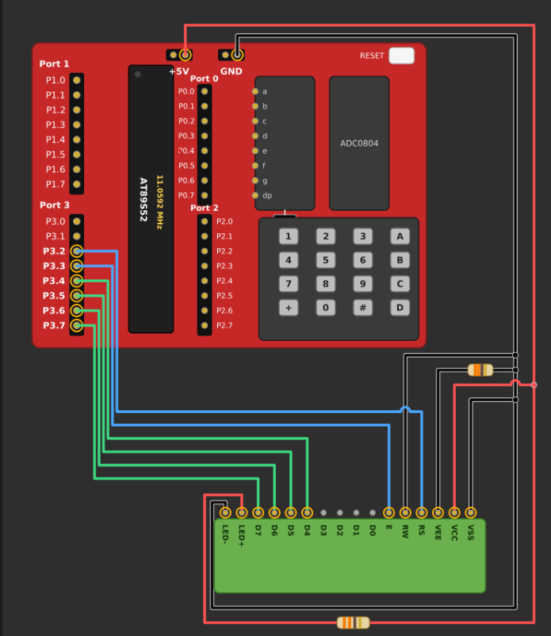

# EXPERIMENT DETAILS

- **Experiment:** Continuous Assessment 7 (CAT 7)
- **Date:** 28.08.2026
- **Name of Experiment:** LCD Cursor Positioning and Dynamic Value Update Using 8051
- **Hardware Setup / Platform:** AT89S52 Microcontroller + 16×2 LCD + Keil µVision (Bare-Metal Embedded C)
- **Crystal Frequency:** 11.0592 MHz
- **Display Interface:** HD44780-Compatible 16×2 Character LCD
- **Communication Mode:** 4-bit GPIO-Based Interface
- **Development Environment:** Keil µVision using Embedded C (Keil C51).

---

## TASK 7B: Cursor Positioning and Dynamic Value Update

### 1. Circuit Diagram & Hardware Description

The experiment implements cursor positioning and dynamic data display using a 16×2 character LCD interfaced with the AT89S52 microcontroller. The LCD operates in 4-bit communication mode, allowing the microcontroller to send commands and character data through GPIO pins.

The experiment focuses on developing functions to position the LCD cursor at a specified row and column, display strings and print numerical values. This allows text and numerical data to be displayed at specific locations on the LCD.

- **Microcontroller:** AT89S52 (8051)
- **Display Device:** 16×2 Character LCD
- **LCD Controller:** HD44780-Compatible
- **Communication Interface:** GPIO
- **Communication Mode:** 4-bit Mode
- **Display Configuration:** 2 Lines × 16 Characters
- **Register Select Pin (RS):** P3.2
- **Enable Pin (EN):** P3.3
- **LCD Data Pins (D4–D7):** P3.4–P3.7
- **Read/Write Pin (RW):** Ground (Write Mode)
- **LCD Power Supply:** 5V
- **Development Environment:** Keil µVision using Embedded C (Keil C51).

## Circuit Diagram

### 2. Core Logic / Pseudocode / Code Base

#### Working Principle

The program uses a 4-bit GPIO-based LCD driver to initialize and control a 16×2 character LCD. Additional functions are implemented to control the cursor position, display strings and print numerical values.

The `lcd_goto()` function positions the cursor at a specified row and column. The `lcd_puts()` function displays strings character by character, while `lcd_print_number()` converts an unsigned integer into individual decimal digits and displays them on the LCD.

1. **GPIO Configuration:** The RS and EN control pins are assigned to P3.2 and P3.3, while P3.4–P3.7 are used for LCD data transmission.
2. **LCD Initialization:** The LCD is initialized in 4-bit, 2-line mode using the required HD44780-compatible command sequence.
3. **Cursor Positioning:** The `lcd_goto(row, column)` function positions the cursor at the specified location using the LCD DDRAM address commands.
4. **First Row Selection:** The command `0x80 + column` selects the required column on the first row.
5. **Second Row Selection:** The command `0xC0 + column` selects the required column on the second row.
6. **String Display:** The `lcd_puts(string)` function transmits each character of the string until the null terminator is encountered.
7. **Numerical Value Display:** The `lcd_print_number(value)` function extracts individual decimal digits using division and modulus operations.
8. **Digit Transmission:** Each extracted digit is converted into its corresponding ASCII character by adding `'0'` and transmitted using the `lcd_data()` function.
9. **Display Output:** The program displays strings and numerical values at specified cursor positions on both LCD rows.

#### LCD Configuration

| Parameter | Configuration |
|---|---|
| LCD Type | 16×2 Character LCD |
| Controller | HD44780-Compatible |
| Interface Mode | 4-bit GPIO |
| Display Lines | 2 |
| Characters per Line | 16 |
| Data Pins | P3.4–P3.7 |
| RS Pin | P3.2 |
| EN Pin | P3.3 |
| RW Pin | Ground |
| Function Set | `0x28` |
| Display Control | `0x0C` |
| Entry Mode | `0x06` |
| Clear Display | `0x01` |

#### LCD Cursor Positioning

The LCD uses DDRAM addresses to identify cursor positions on the display.

The following commands are used:

**1. First Row:**

`0x80 + column`

- Selects the first row.
- Positions the cursor at the specified column.
- Column numbering starts from 0.

**2. Second Row:**

`0xC0 + column`

- Selects the second row.
- Positions the cursor at the specified column.
- Column numbering starts from 0.

The `lcd_goto(row, column)` function selects the appropriate command depending on the specified row.

#### Numerical Value Conversion

The `lcd_print_number()` function converts an unsigned integer into individual decimal digits before displaying them.

For example, to display the number 13:

1. Initialize the divisor to 10000.
2. Divide the number by the divisor to extract the current digit.
3. Skip leading zeros.
4. Convert the extracted digit into its ASCII equivalent by adding `'0'`.
5. Transmit the digit using `lcd_data()`.
6. Use the modulus operator to remove the extracted digit.
7. Reduce the divisor by dividing it by 10.
8. Repeat until all digits are displayed.

For the input value 13, the LCD displays the characters `'1'` and `'3'`.

#### Pseudocode

1. Include the 8051 register definition header file (`reg51.h`).
2. Define the RS and EN control pins.
3. Implement the `delay_ms()` function to generate software delays.
4. Implement the `lcd_pulse()` function to generate an enable pulse.
5. Implement the `lcd_send_nibble()` function to transmit 4-bit data.
6. Implement the `lcd_cmd()` function to send LCD instructions.
7. Implement the `lcd_data()` function to send individual character data.
8. Define the `lcd_init()` function:
   - Initialize RS and EN to LOW.
   - Wait for the LCD power-up delay.
   - Send the required initialization sequence.
   - Configure the LCD in 4-bit, 2-line mode.
   - Turn ON the display and clear the screen.
9. Implement the `lcd_goto(row, column)` function:
   - Check whether the selected row is 0 or 1.
   - Send the corresponding DDRAM address command.
   - Position the cursor at the specified column.
10. Implement the `lcd_puts(string)` function to display strings character by character.
11. Implement the `lcd_print_number(value)` function:
    - Initialize the divisor to 10000.
    - Extract individual decimal digits using division.
    - Skip leading zeros.
    - Convert each digit into its ASCII equivalent.
    - Display each digit using `lcd_data()`.
12. In the `main()` function:
    - Call `lcd_init()` to initialize the LCD.
    - Position the cursor at row 0, column 0.
    - Display the string "HI".
    - Position the cursor at row 1, column 3.
    - Display the string "There".
    - Position the cursor at row 0, column 8.
    - Display the numerical value 13.
13. Enter an infinite loop to maintain the displayed output.

#### Code Base

The program is developed using Embedded C in Keil µVision for the AT89S52 microcontroller. The `reg51.h` header file provides access to the 8051 GPIO registers.

- The `RS` pin is assigned to P3.2 and the `EN` pin is assigned to P3.3.
- The `delay_ms()` function generates software delays required for LCD operations.
- The `lcd_pulse()` function generates an enable pulse to transfer data to the LCD.
- The `lcd_send_nibble()` function transmits 4-bit data through P3.4–P3.7.
- The `lcd_cmd()` function sends instructions to the LCD by setting RS = 0.
- The `lcd_data()` function sends individual characters by setting RS = 1.
- The `lcd_init()` function initializes the LCD in 4-bit, 2-line mode using the required command sequence.
- The `lcd_goto()` function positions the cursor at a specified row and column by sending the corresponding DDRAM address command.
- The `lcd_puts()` function displays strings by transmitting each character individually until the null terminator is encountered.
- The `lcd_print_number()` function converts an unsigned integer into individual decimal digits using division and modulus operations.
- Each numerical digit is converted into its ASCII equivalent and transmitted to the LCD using `lcd_data()`.
- In the `main()` function, the LCD is initialized before displaying strings and numerical values.
- The string "HI" is displayed at the beginning of the first row.
- The string "There" is displayed starting from column 3 of the second row.
- The numerical value 13 is displayed starting from column 8 of the first row.

### 3. Inference

**Execution Behavior:** The LCD is successfully initialized in 4-bit, 2-line mode using the AT89S52 microcontroller. The program displays strings and numerical values at specified cursor positions on the 16×2 LCD.

**Cursor Positioning:** The `lcd_goto()` function enables precise cursor movement between rows and columns using LCD DDRAM addresses.

**String Display:** The `lcd_puts()` function displays strings character by character, allowing text to be printed from any selected cursor position.

**Dynamic Value Update:** The `lcd_print_number()` function converts numerical values into individual decimal digits and displays them on the LCD. This demonstrates the conversion of integer values into printable ASCII characters.

**Technical Learning Outcomes:** The experiment demonstrates GPIO-based LCD interfacing, 4-bit communication, LCD initialization, cursor positioning, DDRAM address selection, string display, integer-to-ASCII conversion and numerical value display using Embedded C on the AT89S52 microcontroller.