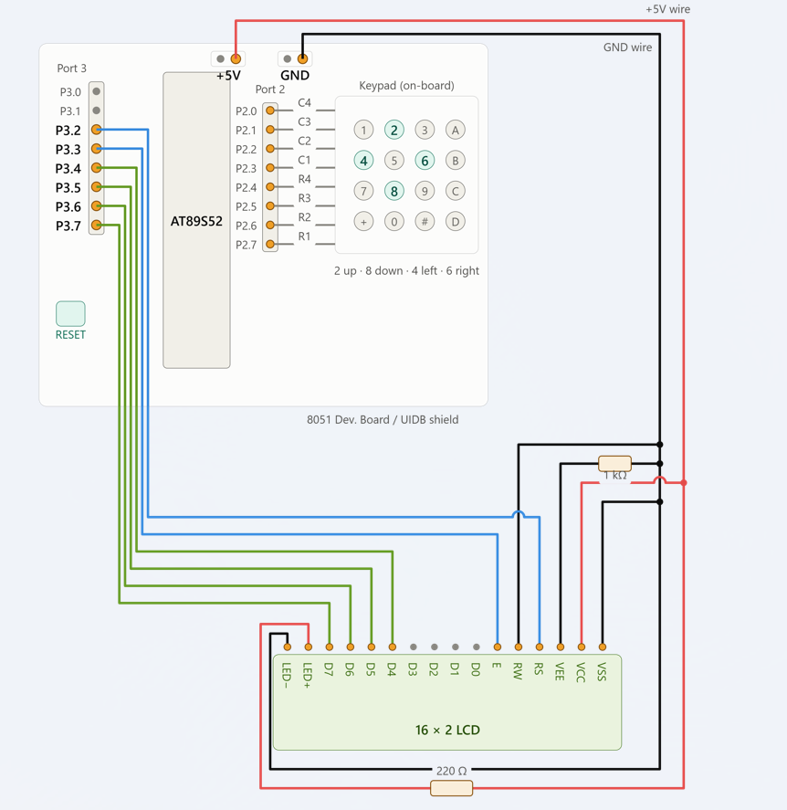

# EXPERIMENT DETAILS

- **Experiment:** Continuous Assessment 7 (CAT 7)
- **Date:** 28.08.2026
- **Name of Experiment:** 4×4 Keypad-Based Character Movement on 16×2 LCD Using 8051
- **Hardware Setup / Platform:** AT89S52 Microcontroller + 16×2 LCD + 4×4 Matrix Keypad + Keil µVision (Bare-Metal Embedded C)
- **Crystal Frequency:** 11.0592 MHz
- **Display Interface:** HD44780-Compatible 16×2 Character LCD
- **Communication Mode:** 4-bit GPIO-Based Interface
- **Development Environment:** Keil µVision using Embedded C (Keil C51).

---

## TASK 7C: 4×4 Keypad-Based Character Movement

### 1. Circuit Diagram & Hardware Description

The experiment implements an interactive character movement application using a 4×4 matrix keypad interfaced with the AT89S52 microcontroller and a 16×2 character LCD.

The LCD operates in 4-bit communication mode and displays a character ('*') whose position changes according to the directional keys pressed on the keypad.

The experiment focuses on matrix keypad scanning, key detection, directional input mapping and dynamic cursor positioning. The microcontroller continuously scans the keypad and updates the character position on the LCD according to the detected key.

Four keypad keys are assigned as directional controls:

- Key 2: Moves the character Up.
- Key 8: Moves the character Down.
- Key 4: Moves the character Left.
- Key 6: Moves the character Right.

Horizontal movement supports wrap-around navigation between column 0 and column 15, while vertical movement switches between the two LCD rows.

**Hardware Configuration:**

- **Microcontroller:** AT89S52 (8051)
- **Display Device:** 16×2 Character LCD
- **LCD Controller:** HD44780-Compatible
- **Communication Interface:** GPIO
- **Communication Mode:** 4-bit Mode
- **Display Configuration:** 2 Lines × 16 Characters
- **Register Select Pin (RS):** P3.2
- **Enable Pin (EN):** P3.3
- **LCD Data Pins (D4–D7):** P3.4–P3.7
- **Keypad:** 4×4 Matrix Keypad
- **Keypad Columns (C1–C4):** P2.3–P2.0
- **Keypad Rows (R1–R4):** P2.7–P2.4
- **Read/Write Pin (RW):** Ground (Write Mode)
- **LCD Power Supply:** 5V
- **Development Environment:** Keil µVision using Embedded C (Keil C51).

## Circuit Diagram

### 2. Core Logic / Pseudocode / Code Base

#### Working Principle

The program uses matrix scanning to detect key presses on a 4×4 keypad and updates the position of a character ('*') displayed on a 16×2 LCD.

The keypad is interfaced through Port 2 of the AT89S52 microcontroller. The four row pins are activated sequentially by setting one row LOW at a time, while the column pins are monitored to identify the pressed key.

The `keypad_scan()` function detects the directional keys and returns their corresponding key values. The `move_character()` function erases the character from its previous position, updates the row and column coordinates based on the detected key, and displays the character at the new position.

1. **GPIO Configuration:** Pins P3.2 and P3.3 are assigned as LCD RS and EN control pins. P3.4–P3.7 are used for LCD data transmission, while Port 2 is used for keypad interfacing.
2. **LCD Initialization:** The LCD is initialized in 4-bit, 2-line mode using the required HD44780-compatible command sequence.
3. **Keypad Configuration:** Port 2 is initialized to `0xFF` so that the keypad rows and columns are initially set HIGH.
4. **Matrix Scanning:** The `keypad_scan()` function activates each keypad row sequentially by setting one row LOW while keeping the remaining rows HIGH.
5. **Key Detection:** The column pins are checked for LOW signals to identify the pressed key.
6. **Debouncing:** A software delay of 20 ms is introduced after detecting a key press. The column is checked again to confirm that the key is still pressed.
7. **Key Release Detection:** The program waits until the pressed key is released before returning the detected key value, preventing repeated detection of the same press.
8. **Key Mapping:** The detected keys are mapped to directional movement:
   - Key 2 moves the character to Row 0.
   - Key 8 moves the character to Row 1.
   - Key 4 moves the character one column to the left.
   - Key 6 moves the character one column to the right.
9. **Character Erasing:** The `move_character()` function moves the LCD cursor to the previous character position and displays a blank space to erase the old character.
10. **Position Updating:** The row and column variables are updated according to the detected directional key. Horizontal movement includes wrap-around handling.
11. **Display Updating:** The cursor is moved to the updated coordinates using `lcd_goto(row, col)`, and the character '*' is displayed at the new position.
12. **Continuous Operation:** The main program continuously scans the keypad and updates the LCD whenever a valid directional key is detected.

#### LCD & Keypad Configuration

| Parameter | Configuration |
|---|---|
| LCD Type | 16×2 Character LCD |
| Controller | HD44780-Compatible |
| LCD Interface Mode | 4-bit GPIO |
| Display Lines | 2 |
| Characters per Line | 16 |
| RS Pin | P3.2 |
| EN Pin | P3.3 |
| LCD Data Pins | P3.4–P3.7 |
| RW Pin | Ground |
| Keypad Type | 4×4 Matrix Keypad |
| Keypad Row Pins | P2.7–P2.4 |
| Keypad Column Pins | P2.3–P2.0 |
| Function Set | `0x28` |
| Display Control | `0x0C` |
| Entry Mode | `0x06` |
| Clear Display | `0x01` |

#### Keypad Mapping Table

The following keys are assigned as directional controls:

| Key Pressed | Action | Position Update |
|---|---|---|
| 2 | Move Up (↑) | Set row = 0 |
| 8 | Move Down (↓) | Set row = 1 |
| 4 | Move Left (←) | Decrement column |
| 6 | Move Right (→) | Increment column |

**Horizontal Boundary Handling:**

- When the character reaches column 0 and the Left key (4) is pressed, it moves to column 15.
- When the character reaches column 15 and the Right key (6) is pressed, it moves to column 0.

**Vertical Boundary Handling:**

- Pressing key 2 moves the character to the first row (Row 0).
- Pressing key 8 moves the character to the second row (Row 1).

#### Matrix Keypad Scanning

The 4×4 keypad consists of four rows and four columns. Each key connects one row to one column.

The scanning process works as follows:

1. Set all keypad pins HIGH initially.
2. Set the first row LOW and check the column pins.
3. Set the second row LOW and check the column pins.
4. Set the third row LOW and check the column pins.
5. Set the fourth row LOW and check the column pins.
6. Identify the pressed key based on the active row and LOW column.
7. Apply a 20 ms debounce delay and verify the key press.
8. Wait until the key is released before returning the detected key value.
9. Return 255 if no valid directional key is detected.

Only four keys are used for directional movement:

- Row 1, Column 2 → Key 2.
- Row 2, Column 1 → Key 4.
- Row 2, Column 3 → Key 6.
- Row 3, Column 2 → Key 8.

#### Pseudocode

1. Include the 8051 register definition header file (`reg51.h`).
2. Define the LCD control pins RS and EN.
3. Define the keypad row pins R1, R2, R3 and R4.
4. Define the keypad column pins C1, C2, C3 and C4.
5. Initialize the global variables:
   - `row = 0`
   - `col = 0`
6. Implement the `delay_ms()` function to generate software delays.
7. Implement the `keypad_scan()` function:
   - Set Port 2 to `0xFF`.
   - Drive Row 1 LOW and check Column 2.
   - If pressed, apply a 20 ms debounce delay, verify the key and wait for release.
   - Return 2 if the key is detected.
   - Drive Row 2 LOW and check Column 1 and Column 3.
   - Return 4 or 6 depending on the detected column.
   - Drive Row 3 LOW and check Column 2.
   - Return 8 if the key is detected.
   - Return 255 if no valid directional key is pressed.
8. Implement the LCD functions:
   - `lcd_pulse()` to generate the enable pulse.
   - `lcd_send_nibble()` to transmit 4-bit data.
   - `lcd_cmd()` to send LCD commands.
   - `lcd_putc()` to display individual characters.
   - `lcd_init()` to initialize the LCD.
   - `lcd_goto()` to position the cursor.
9. Implement the `move_character(key)` function:
   - Move the cursor to the current row and column.
   - Display a blank space to erase the previous character.
   - If key == 2, set row = 0.
   - If key == 8, set row = 1.
   - If key == 6, increment the column and wrap from 15 to 0.
   - If key == 4, decrement the column and wrap from 0 to 15.
   - Move the cursor to the updated position.
   - Display the character '*'.
10. In the `main()` function:
    - Initialize Port 2 to `0xFF`.
    - Initialize Port 3 to `0x00`.
    - Call `lcd_init()`.
    - Set the initial character position to row 0, column 0.
    - Display '*' at the initial position.
11. Enter an infinite loop:
    - Continuously call `keypad_scan()`.
    - Check whether the returned key is 2, 4, 6 or 8.
    - If a valid key is detected, call `move_character(key)`.
12. Repeat continuously to allow interactive character movement using the keypad.

#### Code Base

The program is developed using Embedded C in Keil µVision for the AT89S52 microcontroller. The `reg51.h` header file provides access to the 8051 GPIO registers.

- The `RS` and `EN` pins are assigned to P3.2 and P3.3, respectively.
- The keypad column pins C1, C2, C3 and C4 are assigned to P2.3, P2.2, P2.1 and P2.0.
- The keypad row pins R1, R2, R3 and R4 are assigned to P2.7, P2.6, P2.5 and P2.4.
- The global variables `row` and `col` maintain the current LCD character position.
- The `delay_ms()` function generates software delays for LCD operations and keypad debouncing.
- The `keypad_scan()` function performs matrix scanning by activating one row at a time and monitoring the column pins.
- A 20 ms delay is applied after detecting a key press, followed by another check to verify that the key is still pressed.
- The program waits for the key to be released before returning the corresponding key value.
- The `lcd_pulse()` function generates an enable pulse to transfer data to the LCD.
- The `lcd_send_nibble()` function transmits 4-bit data through P3.4–P3.7 while preserving the lower control-pin bits of Port 3.
- The `lcd_cmd()` function sends instructions to the LCD by setting RS = 0.
- The `lcd_putc()` function sends individual character data by setting RS = 1.
- The `lcd_init()` function initializes the LCD in 4-bit, 2-line mode.
- The `lcd_goto()` function positions the LCD cursor at the specified row and column using DDRAM address commands.
- The `move_character()` function first erases the character from its previous position and then updates the row or column according to the detected directional key.
- Horizontal movement includes wrap-around handling at both column boundaries.
- The updated character position is displayed using the `lcd_goto()` and `lcd_putc()` functions.
- In the `main()` function, the LCD is initialized and the character '*' is displayed at the initial position (0, 0).
- The main loop continuously scans the keypad and calls `move_character()` whenever a valid directional key is detected.

### 3. Inference

**Execution Behavior:** The application successfully initializes the 16×2 character LCD in 4-bit mode and displays the character '*' at the initial position (0, 0). The microcontroller continuously scans the 4×4 keypad for user input. When a valid directional key is pressed, the character is erased from its previous location and displayed at the updated position.

**Keypad Matrix Scanning:** The experiment demonstrates matrix keypad scanning by activating individual rows and monitoring the column signals. Software debouncing and key-release detection help prevent false and repeated key detections.

**Interactive Character Movement:** The keys 2, 4, 6 and 8 are used to control the character's movement across the LCD. The program updates the row and column coordinates according to the detected directional input.

**Boundary Handling:** Horizontal navigation supports wrap-around movement between column 0 and column 15. Vertical navigation switches between the first and second LCD rows.

**Display Updating:** The previous character position is cleared before displaying the character at the new coordinates, preventing unwanted traces on the LCD.

**Technical Learning Outcomes:** This experiment demonstrates GPIO-based LCD interfacing, 4-bit LCD communication, 4×4 matrix keypad interfacing, row-column scanning, active-LOW key detection, software debouncing, key-release detection, cursor positioning, boundary handling and interactive character movement using Embedded C on the AT89S52 microcontroller.