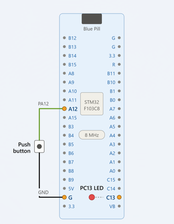

# EXPERIMENT DETAILS

**EXP:** CONTINUOUS ASSESSMENT 8 (CAT 8)

**DATE:** 24.09.2026

**NAME OF EXP:** STM32 GPIO Input/Output – Switch-Controlled LED

**HARDWARE SETUP / PLATFORM:** STM32CubeMX + Keil MDK + STM32 Blue Pill Development Board (STM32F103C8T6)

---

## TASK 8A – GPIO Input/Output

### 1. Circuit Diagram

The experiment uses an external push button connected to GPIO pin PA12 to control the onboard LED of the STM32 Blue Pill development board.

- **Development Board:** STM32 Blue Pill
- **Microcontroller IC:** STM32F103C8T6
- **Input GPIO Pin:** PA12
- **Output GPIO Pin:** PC13
- **Input Peripheral:** Push Button / Switch
- **Output Peripheral:** Onboard LED

## Circuit Diagram

### 2. Core Logic / Pseudocode / Code Base

**Working Principle:**

The experiment demonstrates GPIO input and output operations using the STM32 HAL library.

The PA12 pin is configured as a digital input with an internal pull-up resistor, while PC13 is configured as a digital output to control the onboard LED.

The microcontroller continuously reads the state of PA12 using `HAL_GPIO_ReadPin()`.

- When the push button is pressed, PA12 becomes LOW (`GPIO_PIN_RESET`), and the LED is turned ON by setting PC13 LOW.
- When the push button is released, PA12 becomes HIGH (`GPIO_PIN_SET`), and the LED is turned OFF by setting PC13 HIGH.

**Pseudocode:**

1. Initialize the HAL library using `HAL_Init()`.
2. Configure the system clock.
3. Initialize GPIO peripherals.
4. Configure PA12 as an input with an internal pull-up resistor.
5. Configure PC13 as a push-pull output.
6. Continuously read the input state of PA12.
7. If PA12 is LOW, set PC13 LOW to turn ON the LED.
8. Otherwise, set PC13 HIGH to turn OFF the LED.
9. Repeat the process continuously.

**Code Base:**

The experiment uses the following STM32 HAL functions:

- `HAL_Init()` – Initializes the HAL library.
- `SystemClock_Config()` – Configures the system clock.
- `MX_GPIO_Init()` – Initializes GPIO pins and their configurations.
- `HAL_GPIO_ReadPin()` – Reads the state of the push button connected to PA12.
- `HAL_GPIO_WritePin()` – Controls the onboard LED connected to PC13.

### 3. Inference

The onboard LED of the STM32 Blue Pill responds to the state of the external push button. Pressing the button turns the LED ON, while releasing it turns the LED OFF.

The experiment demonstrates GPIO input reading, output control, internal pull-up configuration, and interfacing of an external switch with the STM32 microcontroller using HAL functions.