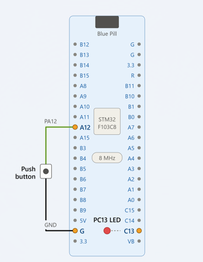

# EXPERIMENT DETAILS

**EXP:** CONTINUOUS ASSESSMENT 8 (CAT 8)

**DATE:**

**NAME OF EXP:** STM32 GPIO Event-Based Control – Switch-Controlled LED Toggle

**HARDWARE SETUP / PLATFORM:** STM32CubeMX + Keil MDK + STM32 Blue Pill Development Board (STM32F103C8T6)

---

## TASK 8B – Event-Based Control

### 1. Circuit Diagram

The experiment uses an external push button connected to GPIO pin PA12 to control the onboard LED of the STM32 Blue Pill development board.

- **Development Board:** STM32 Blue Pill
- **Microcontroller IC:** STM32F103C8T6
- **Input GPIO Pin:** PA12
- **Output GPIO Pin:** PC13
- **Input Peripheral:** Push Button / Switch
- **Output Peripheral:** Onboard LED

## Circuit Diagram

### 2. Core Logic / Pseudocode / Code Base

**Working Principle:**

The experiment demonstrates event-based GPIO control using the STM32 HAL library.

The PA12 pin is configured as a digital input with an internal pull-up resistor, while PC13 is configured as a digital output to control the onboard LED.

Instead of directly controlling the LED based on the current button state, the program detects a change in the button state.

A variable `pressed` is used to track the previous button state.

- When the button is released, PA12 reads HIGH (`GPIO_PIN_SET`), and the variable `pressed` is set to 1.
- When the button is pressed, PA12 reads LOW (`GPIO_PIN_RESET`).
- If `pressed` is already 1, the LED state is toggled using `HAL_GPIO_TogglePin()`, and `pressed` is reset to 0.
- This ensures that a normal press event toggles the LED instead of continuously changing its state while the button remains pressed.

**Pseudocode:**

1. Initialize the HAL library using `HAL_Init()`.
2. Configure the system clock.
3. Initialize GPIO peripherals.
4. Configure PA12 as an input with an internal pull-up resistor.
5. Configure PC13 as a push-pull output.
6. Initialize the variable `pressed` to 0.
7. Continuously read the state of PA12.
8. If PA12 is HIGH, set `pressed` to 1.
9. If PA12 becomes LOW and `pressed` is 1:
   - Toggle the LED using `HAL_GPIO_TogglePin()`.
   - Reset `pressed` to 0.
10. Repeat the process continuously.

**Code Base:**

The experiment uses the following STM32 HAL functions:

- `HAL_Init()` – Initializes the HAL library.
- `SystemClock_Config()` – Configures the system clock.
- `MX_GPIO_Init()` – Initializes the GPIO pins.
- `HAL_GPIO_ReadPin()` – Reads the state of the push button connected to PA12.
- `HAL_GPIO_TogglePin()` – Changes the current state of the onboard LED connected to PC13.

### 3. Inference

The onboard LED toggles its state whenever the push button is pressed. Unlike Task 8A, where the LED directly follows the button state, Task 8B uses event-based control to change the LED state once for each normal press event.

The experiment demonstrates GPIO state monitoring, press-event detection, and LED toggling using STM32 HAL functions.

Switch bounce may cause multiple toggles during a single physical press. The current implementation does not include a debounce mechanism.