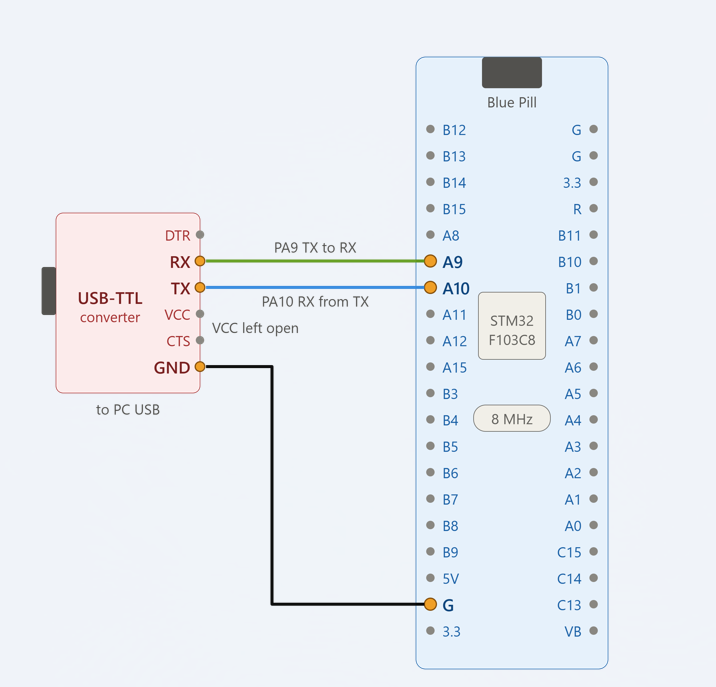

# EXPERIMENT DETAILS

**EXP:** CONTINUOUS ASSESSMENT 9 (CAT 9)

**DATE:**

**NAME OF EXP:** STM32 UART Communication – Character Transmission and String Reception with Echo

**HARDWARE SETUP / PLATFORM:** STM32CubeMX + Keil MDK + STM32 Blue Pill Development Board (STM32F103C8T6) + PC Serial Terminal

---

## TASK 9A – Basic UART Communication

### 1. Circuit Diagram

The experiment establishes serial communication between the STM32 Blue Pill development board and a PC terminal using the USART1 peripheral.

- **Development Board:** STM32 Blue Pill
- **Microcontroller IC:** STM32F103C8T6
- **UART Peripheral:** USART1
- **TX Pin:** PA9
- **RX Pin:** PA10
- **Communication Interface:** USB-to-TTL Serial Converter
- **Terminal Software:** Serial Terminal (e.g., PuTTY / Tera Term)
- **Baud Rate:** 115200
- **Data Bits:** 8
- **Stop Bits:** 1
- **Parity:** None

## Circuit Diagram

### 2. Core Logic / Pseudocode / Code Base

**Working Principle:**

The experiment demonstrates UART-based serial communication between the STM32 microcontroller and a PC terminal using the STM32 HAL library.

USART1 is configured in transmit and receive mode with a baud rate of 115200, 8 data bits, 1 stop bit, and no parity.

**Part 1 – Transmit a Character / Message:**

The UART transmitter is initialized using `MX_USART1_UART_Init()`.

The program uses `HAL_UART_Transmit()` to send data from the STM32 to the PC terminal.

A welcome message, `"STM32 Blue Pill String Echo Ready:"`, is transmitted when the microcontroller starts execution.

**Part 2 – Receive and Echo:**

The program continuously waits for characters sent from the PC terminal using `HAL_UART_Receive()`.

- Each received character is immediately transmitted back to the PC terminal.
- The received characters are stored in a buffer of size 64.
- When the Enter key is pressed (carriage return or newline), the reception loop terminates.
- The received string is terminated with a null character (`'\0'`).
- The program uses `snprintf()` to prepare a confirmation message in the format `"You sent: [received string]"`.
- The complete confirmation message is transmitted back to the PC terminal using `HAL_UART_Transmit()`.

The `memset()` function clears the receive buffer before accepting a new string, allowing multiple messages to be received continuously.

**Pseudocode:**

1. Initialize the HAL library using `HAL_Init()`.
2. Configure the system clock.
3. Initialize GPIO peripherals.
4. Configure USART1 for UART communication.
5. Set the baud rate to 115200.
6. Configure 8 data bits, 1 stop bit, and no parity.
7. Enable both UART transmission and reception.
8. Declare a receive buffer of size 64.
9. Transmit a welcome message to the PC terminal.
10. Continuously execute the following operations:
    - Clear the receive buffer using `memset()`.
    - Initialize the buffer index to zero.
    - Receive one character at a time using `HAL_UART_Receive()`.
    - Immediately transmit each received character back using `HAL_UART_Transmit()`.
    - Store the received character in the buffer.
    - If a carriage return or newline is received, terminate the string.
    - Format a confirmation message using `snprintf()`.
    - Transmit the complete confirmation message to the PC terminal.
11. Repeat the process for subsequent input strings.

**Code Base:**

The experiment uses the following STM32 HAL functions and C library functions:

- `HAL_Init()` – Initializes the HAL library.
- `SystemClock_Config()` – Configures the system clock.
- `MX_USART1_UART_Init()` – Initializes USART1 with the required serial communication settings.
- `HAL_UART_Transmit()` – Transmits characters and messages from the STM32 to the PC terminal.
- `HAL_UART_Receive()` – Receives characters sent from the PC terminal.
- `HAL_GetTick()` – Not used in this experiment.
- `memset()` – Clears the receive buffer before receiving a new string.
- `strlen()` – Calculates the length of the welcome message.
- `snprintf()` – Formats the received string into a confirmation message.

### 3. Inference

The experiment successfully establishes UART serial communication between the STM32 Blue Pill and a PC terminal using USART1.

The STM32 transmits an initial welcome message, receives characters entered through the PC terminal, and immediately echoes each character back. After the Enter key is pressed, the complete received string is displayed again as a confirmation message.

The experiment demonstrates UART peripheral configuration, serial character transmission, string reception, character echoing, and buffer-based data handling using STM32 HAL functions.