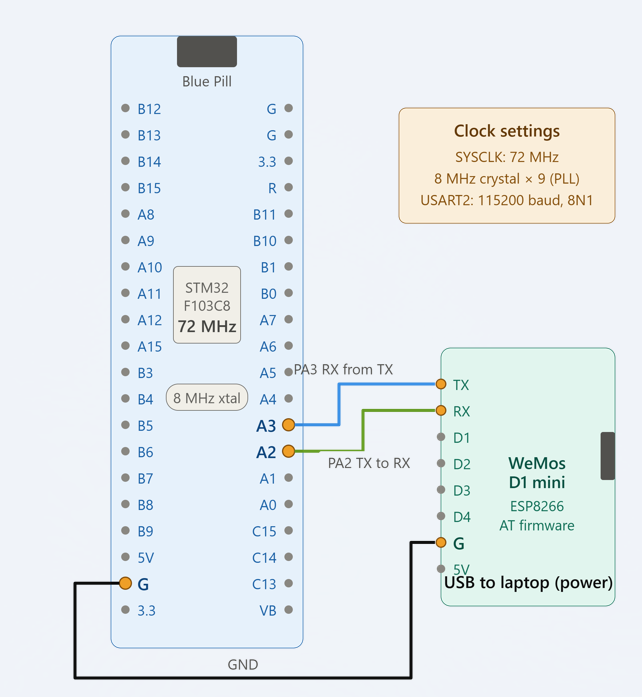

# EXPERIMENT DETAILS

**EXP:** CONTINUOUS ASSESSMENT 10 (CAT 10) 
**DATE:**  
**NAME OF EXP:** UART Communication and Wi-Fi Configuration of ESP8266 Using STM32  
**HARDWARE SETUP / PLATFORM:** STM32 Blue Pill (STM32F103C8T6) + ESP8266/Wemos Wi-Fi Module + UART Communication + STM32CubeIDE / Keil MDK

---

## TASK 10A – UART Communication Between STM32 and ESP8266

### 1. Circuit Diagram

The STM32 Blue Pill communicates with the ESP8266 Wi-Fi module using USART2. USART1 is used to display the responses received from the ESP8266 through a serial monitor.

**Hardware Connections:**

| STM32 Blue Pill | ESP8266 / Wemos |
|---|---|
| PA2 (USART2 TX) | RX |
| PA3 (USART2 RX) | TX |
| GND | GND |

For serial monitoring, USART1 is configured using PA9 (TX) and PA10 (RX).

## Circuit Diagram

### 2. Core Logic / Pseudocode / Code Base

**Working Principle:**

1. Initialize the STM32 HAL library and system clock.
2. Initialize USART1 and USART2.
3. Transmit the `AT` command to the ESP8266 through USART2.
4. Receive the response from the ESP8266.
5. Forward the received response through USART1 for monitoring.
6. Repeat the process for subsequent AT commands.

**Pseudocode:**

1. Initialize HAL and configure the system clock.
2. Initialize GPIO, USART1 and USART2.
3. Send an AT command through USART2.
4. Receive the ESP8266 response.
5. Display the response through USART1.
6. Repeat for the required AT commands.

**Code Base:**

| Function / Construct | Description |
|---|---|
| `HAL_UART_Transmit()` | Transmits AT commands to the ESP8266 and forwards received responses to the serial monitor. |
| `HAL_UART_Receive()` | Receives responses from the ESP8266. |
| `MX_USART1_UART_Init()` | Initializes USART1 at 115200 baud rate for serial monitoring. |
| `MX_USART2_UART_Init()` | Initializes USART2 at 115200 baud rate for ESP8266 communication. |
| `strlen()` | Determines the length of the AT command before transmission. |
| `memset()` | Clears the receive buffer before receiving new responses. |

### 3. Inference

UART communication between the STM32 Blue Pill and ESP8266 is established using AT commands. The ESP8266 responses are received through USART2 and forwarded through USART1 for monitoring.

---

## TASK 10B – Wi-Fi Configuration of ESP8266

### 1. Core Logic / Pseudocode / Code Base

**Working Principle:**

The ESP8266 is configured in station mode so that it can connect to an existing Wi-Fi network. DHCP is enabled to obtain network configuration automatically. The `AT+CWJAP` command connects the module to the specified Wi-Fi network, and `AT+CIFSR` retrieves its assigned IP address.

**AT Commands Used:**

| AT Command | Purpose |
|---|---|
| `AT` | Checks communication with ESP8266. |
| `AT+CWMODE=1` | Configures ESP8266 in station mode. |
| `AT+CWDHCP=1,1` | Enables DHCP for the station interface. |
| `AT+CWJAP="SNUC","snu12345"` | Connects ESP8266 to the Wi-Fi network. |
| `AT+CIFSR` | Retrieves the IP address assigned to ESP8266. |

**Pseudocode:**

1. Configure ESP8266 in station mode.
2. Enable DHCP.
3. Connect to the Wi-Fi network using its SSID and password.
4. Wait for the connection to be established.
5. Retrieve and display the assigned IP address.

**Code Base:**

The AT commands are transmitted using `HAL_UART_Transmit()`. The corresponding ESP8266 responses are collected using `HAL_UART_Receive()` and displayed through USART1.

### 2. Inference

The ESP8266 successfully connects to the configured Wi-Fi network in station mode. Its assigned IP address can be used by a browser or Node-RED to access the HTTP server.

---

## OVERALL INFERENCE

This part of the experiment establishes reliable dual-UART communication on the STM32 Blue Pill to interface with the ESP8266 Wi-Fi module and monitor debug responses. By executing sequential AT commands, the ESP8266 is configured in station mode, connects to the target Wi-Fi network via DHCP, and acquires an IP address ready for network server operations.