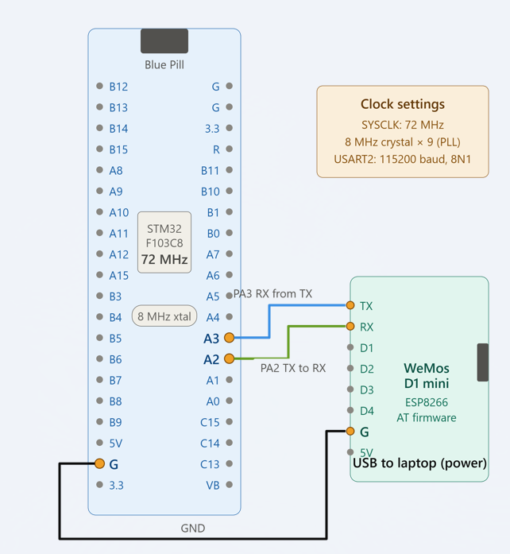

## EXPERIMENT DETAILS

- **Experiment:** Continuous Assessment 11 (CAT 11)

- **Date:** 

- **Name of Experiment:** STM32-Based HTTP Server Using ESP8266 and Node-RED

- **Hardware Setup / Platform:** STM32 Blue Pill (STM32F103C8T6), ESP8266/Wemos Wi-Fi Module, UART Communication, Node-RED, STM32CubeIDE / Keil MDK

---
## Circuit Diagram


## TASK 10C – Configure ESP8266 as a TCP Server

### 1. Core Logic / Working Principle

After connecting to Wi-Fi, the ESP8266 is configured to accept multiple TCP connections. The server is started on port 80, which is commonly used for HTTP communication.

**AT Commands Used:**

```text
AT+CIPMUX=1
AT+CIPSERVER=1,80
```

- `AT+CIPMUX=1` enables multiple TCP connection mode.
- `AT+CIPSERVER=1,80` starts the TCP server on port 80.

**Pseudocode:**

1. Enable multiple connection mode.
2. Start the TCP server on port 80.
3. Wait for incoming network connections.
4. Receive network data from connected clients.

### 2. Code Base

The AT commands are transmitted through USART2 using `HAL_UART_Transmit()`. The ESP8266 responses are received using `HAL_UART_Receive()`.

### 3. Inference

The ESP8266 is configured as a TCP server listening on port 80. It can accept HTTP requests from external clients such as a web browser and Node-RED.

---

## TASK 10D – HTTP Request Reception and Response Construction

### 1. Core Logic / Working Principle

When a browser sends an HTTP request to the ESP8266 server, the module forwards the received network data to the STM32 through UART using an `+IPD` notification.

The STM32 identifies the incoming request, extracts the connection ID and constructs an HTTP response containing a status line, headers and an HTML body.

### 2. HTTP Request Reception

A browser sends a request similar to:

```http
GET / HTTP/1.1
Host: 192.168.1.105
```

The ESP8266 forwards the received data in an `+IPD` frame.

**Example:**

```text
+IPD,0,XXX:GET / HTTP/1.1
```

- `+IPD` indicates incoming network data.
- `0` represents the TCP connection ID.
- `XXX` represents the received data length.
- The remaining content contains the HTTP request.

The STM32 searches for the `+IPD,` notification using `strstr()` and extracts the connection ID using `sscanf()`.

### 3. HTTP Response Construction

The HTML body generated by the STM32 contains:

```html
<html>
<body>
<h1>STM32 IoT Node</h1>
<p>Hi sJHA from STM32</p>
<p>Captured data = ...</p>
</body>
</html>
```

The captured data value is generated using `rand()` in the program.

The HTTP response is constructed using `sprintf()`:

```http
HTTP/1.1 200 OK
Content-Type: text/html
Content-Length: <body_length>
Connection: close

<html>...</html>
```

The response consists of:
- HTTP status line indicating `200 OK`.
- Content-Type header specifying HTML content.
- Content-Length header specifying the HTML body size.
- Connection header indicating that the connection will be closed.
- HTML body containing the displayed content.

### 4. Sending HTTP Response Using CIPSEND

The transmission takes place in two steps.

**Step 1 – Send CIPSEND Command**

```c
sprintf(at_cmd, "AT+CIPSEND=%d,%d\r\n", link_id, total_len);
```

The STM32 sends the command through USART2 and waits for the ESP8266 `>` prompt.

**Step 2 – Transmit HTTP Response**

After receiving the prompt, the STM32 transmits the HTTP response string through USART2 using `HAL_UART_Transmit()`.

After transmission, the connection is closed using:

```text
AT+CIPCLOSE=<link_id>
```

### 5. Pseudocode

1. Continuously monitor USART2 for incoming ESP8266 data.
2. Search the received data for the `+IPD,` notification.
3. Extract the TCP connection ID.
4. Generate a captured-data value.
5. Construct the HTML body.
6. Calculate the body length.
7. Construct the complete HTTP response with status line and headers.
8. Calculate the total HTTP response length.
9. Send the `AT+CIPSEND` command with connection ID and response length.
10. Wait for the ESP8266 `>` prompt.
11. Transmit the HTTP response.
12. Close the TCP connection using `AT+CIPCLOSE`.

### 6. Functions and Commands Used

| Function / Construct | Description |
|---|---|
| `HAL_UART_Receive()` | Monitors incoming ESP8266 data through USART2. |
| `HAL_UART_Transmit()` | Transmits AT commands and HTTP responses through USART2. |
| `strstr()` | Searches the received buffer for the `+IPD,` notification. |
| `sscanf()` | Extracts the TCP connection ID from the received notification. |
| `rand()` | Generates a random captured-data value. |
| `sprintf()` | Constructs the HTML body, HTTP response and AT commands. |
| `strlen()` | Determines the length of strings and AT commands. |
| `HAL_GetTick()` | Provides the tick count used for timeout-based prompt detection. |
| `HAL_Delay()` | Introduces a delay before closing the TCP connection. |
| `AT+CIPSEND` | Instructs the ESP8266 to prepare for transmitting the specified number of bytes. |
| `AT+CIPCLOSE` | Closes the specified TCP connection. |

### 7. Inference

The STM32 successfully processes HTTP requests forwarded by the ESP8266 through UART. It constructs an HTTP response containing the appropriate headers and HTML content and transmits it through the ESP8266 to the requesting client.

---

## TASK 10E – Node-RED as a Second HTTP Client

### 1. Node-RED Flow

Node-RED is configured to act as another HTTP client of the STM32-based HTTP server. It sends an HTTP request to the IP address assigned to the ESP8266.

**Node-RED Flow:**

```text
Inject Node
     |
     v
HTTP Request Node
     |
     v
Debug Node
```

### 2. Node Configuration

| Node | Configuration |
|---|---|
| Inject | Triggers the HTTP request. |
| HTTP Request | Sends a GET request to `http://<ESP8266_IP>/`. |
| Debug | Displays the HTTP response received from the server. |

### 3. Working Principle

1. The Inject node triggers the flow.
2. The HTTP Request node sends a GET request to the ESP8266 IP address on port 80.
3. The ESP8266 forwards the HTTP request to the STM32 through UART.
4. The STM32 processes the request and constructs the HTTP response.
5. The ESP8266 transmits the response to Node-RED.
6. The Debug node displays the received HTTP response.

### 4. Inference

Node-RED acts as a second HTTP client and communicates with the STM32-based HTTP server through the ESP8266. The HTTP response generated by the STM32 is received and displayed in the Node-RED Debug panel.

---

## OVERALL INFERENCE

The experiment demonstrates the implementation of an STM32-based HTTP server using the ESP8266 Wi-Fi module. The STM32 Blue Pill communicates with the ESP8266 through UART AT commands, configures it as a TCP server on port 80, and receives incoming HTTP requests through `+IPD` notifications.

It processes the requests, constructs HTTP responses containing HTML content, and transmits them through the ESP8266 to external clients. The server is accessible through both a web browser and Node-RED, demonstrating HTTP communication, UART-based data exchange and IoT device integration.
