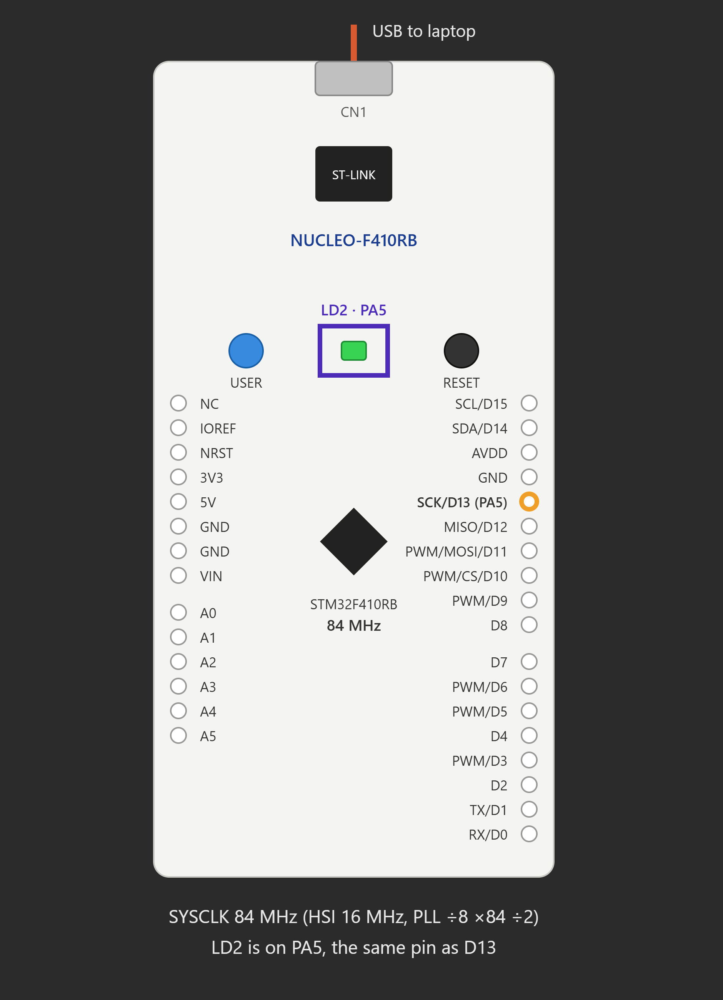

# EXPERIMENT DETAILS

**EXP:** CONTINUOUS ASSESSMENT 11 (CAT 11)

**DATE:**

**NAME OF EXP:** STM32 GPIO-Based On-board LED Bring-Up

**HARDWARE SETUP / PLATFORM:** STM32CubeMX + Keil MDK + STM32 NUCLEO-F401RB Development Board (STM32F401RB Cortex-M4)

---

## TASK 11A – On-board LED Bring-Up

### 1. Circuit Diagram

The experiment uses the onboard LED of the STM32 NUCLEO-F401RB development board to demonstrate GPIO output configuration and LED blinking at different time intervals.

- **Development Board:** STM32 NUCLEO-F401RB
- **Microcontroller IC:** STM32F401RB
- **LED GPIO Pin:** PA5
- **LED Type:** On-board User LED
- **Clock Source:** HSI with PLL
- **System Clock Frequency:** 84 MHz
- **Programming Interface:** ST-LINK
- **Software:** STM32CubeMX + Keil MDK
- **Programming Language:** Embedded C
- **Libraries:** STM32 HAL

## Circuit Diagram

### 2. Core Logic / Pseudocode / Code Base

**Working Principle:**

The experiment demonstrates GPIO output control using the STM32 HAL library.

The onboard LED connected to GPIO pin PA5 is configured as a general-purpose push-pull output using `HAL_GPIO_Init()`.

The program generates two different LED blinking patterns using nested `while` loops and the `HAL_Delay()` function.

The first pattern produces two fast blinking cycles, where the LED remains ON for 100 ms and OFF for 100 ms.

After completing the fast blinking pattern, the program introduces a delay of 500 ms.

The second pattern produces four slow blinking cycles, where the LED remains ON for 500 ms and OFF for 500 ms.

After completing both patterns, the sequence repeats continuously inside the main infinite loop.

**Pseudocode:**

1. Initialize the HAL library using `HAL_Init()`.
2. Configure the system clock using `SystemClock_Config()`.
3. Initialize GPIO peripherals.
4. Enable GPIOA and GPIOH peripheral clocks.
5. Configure PA5 as a push-pull output with no pull-up or pull-down resistor.
6. Set the initial LED state to LOW.
7. Enter the infinite `while(1)` loop.
8. Initialize the counter variable `i = 1`.
9. Repeat while `i != 3`:
   - Set PA5 HIGH to turn ON the LED.
   - Introduce a delay of 100 ms.
   - Set PA5 LOW to turn OFF the LED.
   - Introduce a delay of 100 ms.
   - Increment `i`.
10. Introduce a delay of 500 ms.
11. Initialize the counter variable `j = 1`.
12. Repeat while `j != 5`:
    - Set PA5 HIGH to turn ON the LED.
    - Introduce a delay of 500 ms.
    - Set PA5 LOW to turn OFF the LED.
    - Introduce a delay of 500 ms.
    - Increment `j`.
13. Repeat the complete blinking sequence continuously.

**Code Base:**

The experiment uses the following STM32 HAL functions and C programming constructs:

- `HAL_Init()` – Initializes the STM32 HAL library.
- `SystemClock_Config()` – Configures the system clock using the HSI oscillator and PLL.
- `MX_GPIO_Init()` – Initializes GPIO peripherals and configures PA5 as an output pin.
- `__HAL_RCC_GPIOA_CLK_ENABLE()` – Enables the GPIOA peripheral clock.
- `__HAL_RCC_GPIOH_CLK_ENABLE()` – Enables the GPIOH peripheral clock.
- `HAL_GPIO_Init()` – Configures PA5 as a general-purpose push-pull output.
- `HAL_GPIO_WritePin()` – Sets or resets PA5 to control the LED ON and OFF states.
- `HAL_Delay()` – Generates software delays for controlling the LED blinking intervals.
- `while(1)` – Continuously executes the blinking sequence.
- `while(i != 3)` and `while(j != 5)` – Control the number of fast and slow blinking cycles.

### 3. Inference

The experiment successfully demonstrates GPIO output configuration and onboard LED control using the STM32 HAL library.

The LED connected to PA5 produces two different blinking patterns: two fast blinking cycles with 100 ms delays and four slow blinking cycles with 500 ms delays.

The experiment demonstrates GPIO initialization, digital output operations, software-based timing using `HAL_Delay()`, and loop-based control structures in STM32 programming.