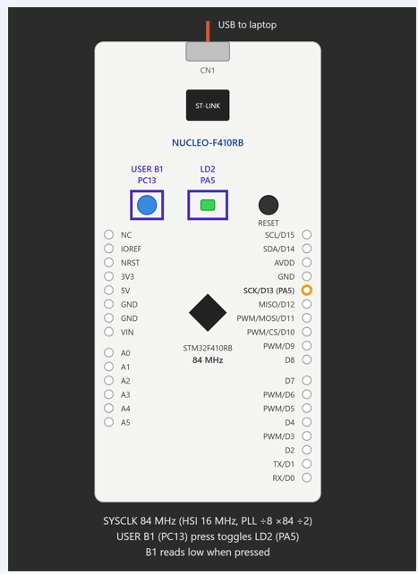

# EXPERIMENT DETAILS

**EXP:** CONTINUOUS ASSESSMENT 11 (CAT 11)

**DATE:**

**NAME OF EXP:** STM32 GPIO-Based Short-Press and Long-Press Detection

**HARDWARE SETUP / PLATFORM:** STM32CubeMX + Keil MDK + STM32 NUCLEO-F401RB Development Board (STM32F401RB Cortex-M4)

---

## TASK 11C – Short-Press and Long-Press Detection

### 1. Circuit Diagram

The experiment uses the onboard push button and onboard LED of the STM32 NUCLEO-F401RB development board to demonstrate button press-duration detection and different LED control operations.

- **Development Board:** STM32 NUCLEO-F401RB
- **Microcontroller IC:** STM32F401RB
- **Push Button GPIO Pin:** PC13
- **LED GPIO Pin:** PA5
- **Button Configuration:** GPIO Input
- **LED Configuration:** GPIO Push-Pull Output
- **Clock Source:** HSI with PLL
- **System Clock Frequency:** 84 MHz
- **Short-Press Duration:** Less than 1000 ms
- **Long-Press Duration:** 1000 ms or more
- **LED Blinking Interval:** 500 ms
- **Programming Interface:** ST-LINK
- **Software:** STM32CubeMX + Keil MDK
- **Programming Language:** Embedded C
- **Libraries:** STM32 HAL

## Circuit Diagram

### 2. Core Logic / Pseudocode / Code Base

**Working Principle:**

The experiment demonstrates short-press and long-press detection using GPIO input monitoring and the STM32 HAL library.

The onboard push button connected to PC13 is configured as a GPIO input, while the onboard LED connected to PA5 is configured as a push-pull output.

The program detects the duration of a button press using the `HAL_GetTick()` function, which returns the number of milliseconds elapsed since the HAL time base started.

Four static variables are used to manage the button state and LED operation:

- `press_time` – Stores the time at which the button is pressed.
- `blink_timer` – Stores the time of the previous LED toggle.
- `blinking` – Indicates whether continuous LED blinking is active.
- `is_pressed` – Tracks whether the button is currently pressed.

When a button press is detected, the current tick count is stored in `press_time`.

When the button is released, the program calculates the press duration by subtracting `press_time` from the current tick count.

The system supports two different operations:

- **Short Press (Less than 1000 ms):** If blinking mode is inactive, the LED state is toggled. If blinking mode is already active, blinking is stopped and the LED is turned ON.
- **Long Press (1000 ms or more):** Continuous LED blinking mode is activated. The LED toggles its state every 500 ms.

The program uses `HAL_GetTick()` for timing instead of `HAL_Delay()`, allowing button monitoring and LED blinking to be handled continuously without blocking the main loop.

**Pseudocode:**

1. Initialize the HAL library using `HAL_Init()`.
2. Configure the system clock using `SystemClock_Config()`.
3. Initialize GPIO peripherals.
4. Enable GPIOA, GPIOC and GPIOH peripheral clocks.
5. Configure PC13 as an input pin.
6. Configure PA5 as a push-pull output pin.
7. Initialize the following static variables:
   - `press_time = 0`
   - `blink_timer = 0`
   - `blinking = 0`
   - `is_pressed = 0`
8. Enter the infinite `while(1)` loop.
9. Read the current button state using `HAL_GPIO_ReadPin()`.
10. If the button is pressed and `is_pressed == 0`:
    - Set `is_pressed = 1`.
    - Store the current tick count in `press_time` using `HAL_GetTick()`.
11. If the button is released and `is_pressed == 1`:
    - Set `is_pressed = 0`.
    - Calculate the button press duration.
12. If the duration is less than 1000 ms:
    - If blinking mode is active:
      - Set `blinking = 0`.
      - Turn the LED ON using `HAL_GPIO_WritePin()`.
    - Otherwise:
      - Toggle the LED using `HAL_GPIO_TogglePin()`.
13. If the duration is 1000 ms or more:
    - Set `blinking = 1`.
    - Store the current tick count in `blink_timer`.
14. If blinking mode is active and 500 ms have elapsed:
    - Toggle the LED state.
    - Update `blink_timer` using `HAL_GetTick()`.
15. Repeat the process continuously.

**Code Base:**

The experiment uses the following STM32 HAL functions and C programming constructs:

- `HAL_Init()` – Initializes the STM32 HAL library and its time base.
- `SystemClock_Config()` – Configures the system clock using the HSI oscillator and PLL.
- `MX_GPIO_Init()` – Initializes GPIO peripherals and configures PC13 and PA5.
- `__HAL_RCC_GPIOA_CLK_ENABLE()` – Enables the GPIOA peripheral clock.
- `__HAL_RCC_GPIOC_CLK_ENABLE()` – Enables the GPIOC peripheral clock.
- `__HAL_RCC_GPIOH_CLK_ENABLE()` – Enables the GPIOH peripheral clock.
- `HAL_GPIO_Init()` – Configures PC13 as an input and PA5 as a push-pull output.
- `HAL_GPIO_ReadPin()` – Reads the current state of the onboard push button.
- `HAL_GPIO_WritePin()` – Sets the LED output to a specified state.
- `HAL_GPIO_TogglePin()` – Toggles the current state of the LED.
- `HAL_GetTick()` – Returns the elapsed system time in milliseconds and is used to calculate button press duration and LED blinking intervals.
- `static uint32_t press_time` – Stores the button press start time.
- `static uint32_t blink_timer` – Stores the previous LED toggle time.
- `static int blinking` – Maintains the continuous blinking mode.
- `static int is_pressed` – Maintains the current button press state.
- Conditional statements (`if-else`) – Distinguish between short and long button presses.
- `while(1)` – Continuously monitors the button and controls the LED without blocking delays.

### 3. Inference

The experiment successfully demonstrates short-press and long-press detection using GPIO input monitoring and the STM32 HAL library.

The system measures the duration of each button press using `HAL_GetTick()` and performs different LED operations based on the measured duration.

A short press toggles the LED state or stops an active blinking operation, while a long press activates continuous LED blinking at 500 ms intervals.

The experiment demonstrates button-duration measurement, conditional control, state management, and non-blocking timing using the STM32 HAL library.

