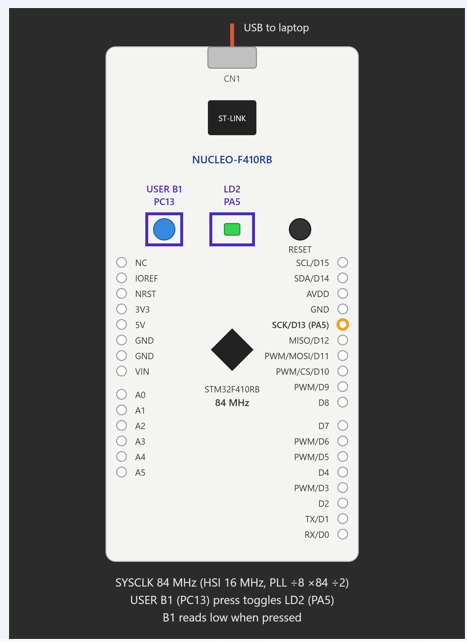

# EXPERIMENT DETAILS

**EXP:** CONTINUOUS ASSESSMENT 12 (CAT 12)

**DATE:**

**NAME OF EXP:** STM32 GPIO-Based On-board Switch Control with State Remembrance

**HARDWARE SETUP / PLATFORM:** STM32CubeMX + Keil MDK + STM32 NUCLEO-F401RB Development Board (STM32F401RB Cortex-M4)

---

## TASK 12B – On-board Switch Control with State Remembrance

### 1. Circuit Diagram

The experiment uses the onboard push button and onboard LED of the STM32 NUCLEO-F401RB development board to demonstrate GPIO input detection and output state control.

- **Development Board:** STM32 NUCLEO-F401RB
- **Microcontroller IC:** STM32F401RB
- **Push Button GPIO Pin:** PC13
- **LED GPIO Pin:** PA5
- **Button Configuration:** GPIO Input
- **LED Configuration:** GPIO Push-Pull Output
- **Clock Source:** HSI with PLL
- **System Clock Frequency:** 84 MHz
- **Programming Interface:** ST-LINK
- **Software:** STM32CubeMX + Keil MDK
- **Programming Language:** Embedded C
- **Libraries:** STM32 HAL

## Circuit Diagram

### 2. Core Logic / Pseudocode / Code Base

**Working Principle:**

The experiment demonstrates GPIO input detection and LED state control using the STM32 HAL library.

The onboard push button connected to PC13 is configured as a GPIO input, while the onboard LED connected to PA5 is configured as a push-pull output.

The program continuously monitors the button state using `HAL_GPIO_ReadPin()`.

A static integer variable named `pressed` is used to remember whether a button press has already been detected.

When PC13 becomes HIGH, the variable `pressed` is set to 1, indicating that a button press has been detected.

When PC13 subsequently becomes LOW and `pressed` is already 1, the program toggles the LED using `HAL_GPIO_TogglePin()` and resets `pressed` to 0.

This ensures that the LED changes its state once for every complete button press and release cycle.

The LED retains its previous state even after the button is released.

**Pseudocode:**

1. Initialize the HAL library using `HAL_Init()`.
2. Configure the system clock using `SystemClock_Config()`.
3. Initialize GPIO peripherals.
4. Enable GPIOA, GPIOC and GPIOH peripheral clocks.
5. Configure PC13 as an input pin.
6. Configure PA5 as a push-pull output pin.
7. Set the initial LED state to LOW.
8. Declare a static integer variable `pressed = 0`.
9. Enter the infinite `while(1)` loop.
10. Continuously read the button state using `HAL_GPIO_ReadPin()`.
11. If PC13 is HIGH:
    - Set `pressed = 1`.
12. If PC13 is LOW and `pressed == 1`:
    - Toggle the LED state using `HAL_GPIO_TogglePin()`.
    - Reset `pressed = 0`.
13. Repeat the process continuously to detect subsequent button presses.

**Code Base:**

The experiment uses the following STM32 HAL functions and C programming constructs:

- `HAL_Init()` – Initializes the STM32 HAL library.
- `SystemClock_Config()` – Configures the system clock using the HSI oscillator and PLL.
- `MX_GPIO_Init()` – Initializes GPIO peripherals and configures PC13 and PA5.
- `__HAL_RCC_GPIOA_CLK_ENABLE()` – Enables the GPIOA peripheral clock.
- `__HAL_RCC_GPIOC_CLK_ENABLE()` – Enables the GPIOC peripheral clock.
- `__HAL_RCC_GPIOH_CLK_ENABLE()` – Enables the GPIOH peripheral clock.
- `HAL_GPIO_Init()` – Configures PC13 as an input and PA5 as a push-pull output.
- `HAL_GPIO_ReadPin()` – Reads the current state of the onboard push button.
- `HAL_GPIO_TogglePin()` – Toggles the current state of the onboard LED.
- `HAL_GPIO_WritePin()` – Initializes the LED output state.
- `static int pressed` – Stores the previously detected button press state.
- `while(1)` – Continuously monitors the button and controls the LED.

### 3. Inference

The experiment successfully demonstrates GPIO input and output operations using the STM32 HAL library.

The onboard push button is continuously monitored, and the LED changes its state when a complete button press and release cycle is detected.

The use of the `pressed` variable allows the program to remember the previous button state and prevent repeated LED toggling while the button remains released.

The experiment demonstrates digital input detection, conditional execution, state remembrance, and GPIO output control using STM32 HAL functions.

