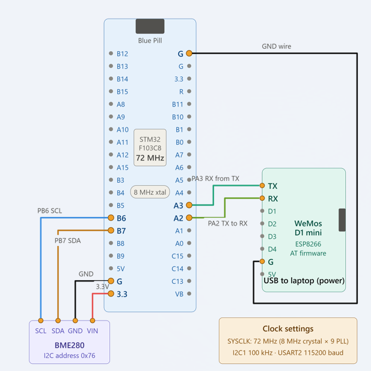

# EXPERIMENT DETAILS

**EXP:** CONTINUOUS ASSESSMENT 13 (CAT 13)

**DATE:**

**NAME OF EXP:** STM32-Based BME280 Environmental Monitoring Using HTTP and Node-RED

**HARDWARE SETUP / PLATFORM:** STM32CubeMX + Keil MDK + STM32 Blue Pill Development Board (STM32F103C8T6) + BME280 Sensor + ESP8266 Wi-Fi Module + Node-RED

---

## TASK 13 – BME280 Sensor Monitoring Using HTTP and Node-RED

### 1. Circuit Diagram

The experiment uses the BME280 environmental sensor interfaced with the STM32 Blue Pill through I2C communication. An ESP8266 Wi-Fi module is connected to the STM32 through UART communication to transmit sensor readings over Wi-Fi using an HTTP server. Node-RED is used to retrieve and visualize the sensor data.

- **Development Board:** STM32 Blue Pill
- **Microcontroller IC:** STM32F103C8T6
- **Environmental Sensor:** BME280
- **Wi-Fi Module:** ESP8266
- **I2C Peripheral:** I2C1
- **I2C SCL Pin:** PB6
- **I2C SDA Pin:** PB7
- **BME280 I2C Address:** 0x76
- **UART Peripheral:** USART2
- **UART TX Pin:** PA2
- **UART RX Pin:** PA3
- **UART Baud Rate:** 115200
- **Communication Protocol:** I2C, UART, HTTP
- **HTTP Server Port:** 80
- **Wi-Fi Mode:** Station Mode
- **Sensor Parameters:** Temperature, Pressure and Humidity
- **Sensor Library:** Bosch BME280 Sensor API
- **Programming Interface:** ST-LINK
- **Software:** STM32CubeMX + Keil MDK + Node-RED
- **Programming Language:** Embedded C
- **Libraries:** STM32 HAL + Bosch BME280 API

**Connection Details:**

**BME280 – STM32 Interface:**

| BME280 Pin | STM32 Blue Pill Pin |
|---|---|
| VCC | 3.3V |
| GND | GND |
| SCL | PB6 |
| SDA | PB7 |

**ESP8266 – STM32 Interface:**

| ESP8266 Pin | STM32 Blue Pill Pin |
|---|---|
| VCC | External 3.3V supply |
| GND | GND |
| TX | PA3 (USART2 RX) |
| RX | PA2 (USART2 TX) |

The STM32 and ESP8266 share a common ground. The ESP8266 is powered directly by the laptop.
## Circuit Diagram

### 2. Core Logic / Pseudocode / Code Base

**Working Principle:**

The experiment demonstrates environmental sensor interfacing, UART-based Wi-Fi communication, HTTP server implementation and IoT data visualization using Node-RED.

The STM32 Blue Pill acts as the main controller, the BME280 measures environmental parameters, and the ESP8266 provides Wi-Fi connectivity.

The implementation consists of the following operations:

**A. BME280 Sensor Initialization**

The STM32 initializes the HAL library and configures the system clock, GPIO, I2C1 and USART2 peripherals.

The Bosch BME280 API is used to initialize the sensor and configure its measurement settings.

The sensor is configured with:

- Temperature oversampling: 1X
- Pressure oversampling: 1X
- Humidity oversampling: 1X
- Filter coefficient: OFF
- Power mode: NORMAL

The BME280 communicates with the STM32 through I2C1 using the primary I2C address `0x76`.

The functions `user_i2c_read()` and `user_i2c_write()` are implemented using `HAL_I2C_Mem_Read()` and `HAL_I2C_Mem_Write()` to provide the I2C communication interface required by the Bosch sensor API.

**B. Sensor Data Acquisition**

The function `bme280_get_sensor_data()` retrieves the environmental readings from the BME280 sensor.

The following parameters are obtained:

- **Temperature:** Measured in degrees Celsius (°C).
- **Pressure:** Measured in Pascal (Pa) and converted into hectopascal (hPa).
- **Humidity:** Measured as relative humidity (%).

Pressure is converted from Pascal to hectopascal by dividing the pressure reading by 100.

The sensor readings are continuously updated at regular intervals.

**C. ESP8266 Wi-Fi Configuration**

The STM32 communicates with the ESP8266 using USART2 and AT commands.

The ESP8266 is configured in station mode using `AT+CWMODE=1`.

It connects to the available Wi-Fi network using `AT+CWJAP`.

After successful connection, the assigned IP address is retrieved using `AT+CIFSR`.

Multiple TCP connections are enabled using `AT+CIPMUX=1`.

The HTTP server is started on port 80 using `AT+CIPSERVER=1,80`.

**D. HTTP Server Implementation**

The ESP8266 acts as the Wi-Fi interface for the STM32-based HTTP server.

When a client sends an HTTP GET request, the ESP8266 forwards the incoming request to the STM32 through UART.

The STM32 processes the received request and prepares an HTTP response containing the latest BME280 sensor readings.

The response is formatted in JSON and contains:

- Temperature
- Pressure
- Humidity
- Sensor status

The HTTP response includes the HTTP status code, Content-Type, Content-Length and Connection headers.

The `AT+CIPSEND` command is used to transmit the HTTP response through the ESP8266.

After transmitting the response, the TCP connection is closed using `AT+CIPCLOSE`.

**E. Node-RED Integration**

Node-RED acts as an HTTP client and retrieves the environmental readings from the ESP8266 HTTP server.

An HTTP GET request is periodically sent to the ESP8266 IP address.

The received JSON response is processed by Node-RED to extract the temperature, pressure and humidity values.

The following nodes are used:

- **Inject Node:** Triggers HTTP requests at regular intervals.
- **HTTP Request Node:** Sends GET requests to the ESP8266 HTTP server.
- **JSON Processing:** Extracts the sensor parameters from the received response.
- **Gauge Nodes:** Display the current temperature, pressure and humidity values.
- **Chart Nodes:** Display changes in sensor readings over time.
- **Debug Node:** Displays the received sensor data in the Debug panel.

The Node-RED dashboard provides a graphical representation of the environmental readings.

**Pseudocode:**

1. Initialize the HAL library using `HAL_Init()`.
2. Configure the system clock using `SystemClock_Config()`.
3. Initialize GPIO peripherals.
4. Initialize I2C1 for BME280 communication.
5. Initialize USART2 for ESP8266 communication.
6. Declare the BME280 device structure, sensor data structure and settings structure.
7. Configure the BME280 I2C address as `0x76`.
8. Configure the I2C read, write and delay callback functions.
9. Initialize the BME280 sensor using `bme280_init()`.
10. Configure temperature, pressure and humidity oversampling to 1X.
11. Disable the sensor filter.
12. Set the sensor to normal operating mode.
13. Configure the ESP8266 using UART AT commands:
    - Set station mode using `AT+CWMODE=1`.
    - Connect to Wi-Fi using `AT+CWJAP`.
    - Retrieve the IP address using `AT+CIFSR`.
    - Enable multiple connections using `AT+CIPMUX=1`.
    - Start the HTTP server using `AT+CIPSERVER=1,80`.
14. Enter the infinite `while(1)` loop.
15. Retrieve temperature, pressure and humidity using `bme280_get_sensor_data()`.
16. Convert pressure from Pascal to hPa.
17. Check for incoming HTTP requests from the ESP8266.
18. Extract the TCP connection ID from the received request.
19. Prepare a JSON response containing the latest sensor readings.
20. Construct the HTTP response with the appropriate headers.
21. Calculate the response length.
22. Send the response using `AT+CIPSEND`.
23. Transmit the HTTP response through USART2.
24. Close the TCP connection using `AT+CIPCLOSE`.
25. Repeat the process continuously.
26. Configure Node-RED to periodically send HTTP GET requests to the ESP8266 IP address.
27. Receive and process the JSON response.
28. Display the temperature, pressure and humidity readings using dashboard gauges, charts and debug output.

**Code Base:**

The experiment uses the following STM32 HAL functions, Bosch BME280 API functions, ESP8266 AT commands and C programming constructs:

**A. STM32 HAL Functions**

- `HAL_Init()` – Initializes the STM32 HAL library.
- `SystemClock_Config()` – Configures the system clock using the HSE oscillator and PLL.
- `MX_GPIO_Init()` – Initializes GPIO peripherals.
- `MX_I2C1_Init()` – Initializes I2C1 communication.
- `MX_USART2_UART_Init()` – Initializes USART2 communication at 115200 baud.
- `HAL_I2C_Mem_Read()` – Reads register data from the BME280 sensor.
- `HAL_I2C_Mem_Write()` – Writes configuration data to the BME280 sensor.
- `HAL_UART_Transmit()` – Transmits AT commands and HTTP response data to the ESP8266.
- `HAL_UART_Receive()` – Receives responses and incoming HTTP requests from the ESP8266.
- `HAL_Delay()` – Provides delays during sensor measurement and communication operations.

**B. Bosch BME280 API Functions**

- `bme280_init()` – Initializes the BME280 sensor and retrieves its calibration data.
- `bme280_set_sensor_settings()` – Configures temperature, pressure and humidity oversampling and filter settings.
- `bme280_set_sensor_mode()` – Configures the sensor operating mode.
- `bme280_get_sensor_data()` – Retrieves temperature, pressure and humidity readings.
- `user_i2c_read()` – Implements the I2C read callback using STM32 HAL functions.
- `user_i2c_write()` – Implements the I2C write callback using STM32 HAL functions.
- `user_delay_us()` – Provides the delay callback required by the Bosch BME280 API.

**C. ESP8266 AT Commands**

- `AT` – Checks communication with the ESP8266.
- `AT+CWMODE=1` – Configures the ESP8266 in station mode.
- `AT+CWJAP` – Connects the ESP8266 to the Wi-Fi network.
- `AT+CIFSR` – Retrieves the assigned IP address.
- `AT+CIPMUX=1` – Enables multiple TCP connections.
- `AT+CIPSERVER=1,80` – Starts the HTTP server on port 80.
- `AT+CIPSEND` – Initiates transmission of HTTP response data.
- `AT+CIPCLOSE` – Closes the TCP connection after sending the response.

**D. HTTP and JSON Handling**

- `sprintf()` – Formats sensor readings into a JSON response and constructs HTTP headers.
- `strlen()` – Calculates the length of the HTTP response.
- `Content-Type: application/json` – Identifies the response as JSON data.
- `Content-Length` – Specifies the length of the HTTP response body.
- `HTTP/1.1 200 OK` – Indicates a successful HTTP request.
- `AT+CIPSEND` – Transmits the prepared HTTP response through the ESP8266.

**E. Node-RED Nodes**

- `Inject Node` – Triggers periodic HTTP requests.
- `HTTP Request Node` – Sends HTTP GET requests to the ESP8266.
- `JSON Processing` – Processes the received JSON data.
- `Gauge Node` – Displays current sensor readings.
- `Chart Node` – Displays sensor readings over time.
- `Debug Node` – Displays received data in the Debug panel.

### 3. Inference

The experiment successfully demonstrates the integration of the BME280 environmental sensor, STM32 Blue Pill microcontroller, ESP8266 Wi-Fi module and Node-RED platform for IoT-based environmental monitoring.

The BME280 sensor communicates with the STM32 through I2C1 and provides temperature, pressure and humidity readings.

The STM32 processes the sensor data and communicates with the ESP8266 through USART2 using AT commands.

The ESP8266 provides Wi-Fi connectivity and enables the sensor readings to be accessed through an HTTP server using GET requests.

Node-RED retrieves the sensor readings in JSON format and displays them through dashboard gauges, charts and debug output.

The experiment demonstrates I2C sensor interfacing, UART communication, Wi-Fi connectivity, HTTP client-server communication, JSON data handling and IoT-based real-time sensor monitoring.
