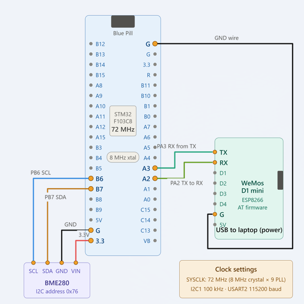

# EXPERIMENT DETAILS

**EXP:** CONTINUOUS ASSESSMENT  14 (CAT 14)

**DATE:** 29.10.2026 

**NAME OF EXP:** BME280-Based Environmental Monitoring Using MQTT and Node-RED  

**HARDWARE SETUP / PLATFORM:** STM32 Blue Pill (STM32F103C8T6) + BME280 Sensor + ESP8266 Wi-Fi Module + Node-RED + EMQX MQTT Broker + STM32CubeIDE / Keil MDK

---

## TASK 14 – BME280 Sensor Data Monitoring Using MQTT and Node-RED

### 1. Circuit Diagram

The STM32 Blue Pill communicates with the BME280 sensor through the I2C1 interface and communicates with the ESP8266 Wi-Fi module through USART2. The ESP8266 connects to a Wi-Fi network and sends sensor readings to a public MQTT broker. Node-RED subscribes to the MQTT topic and displays the received sensor values on a live dashboard.

**Hardware Connections:**

**BME280 to STM32 Blue Pill (I2C1)**

| BME280 | STM32 Blue Pill |
|---|---|
| VCC | 3.3V |
| GND | GND |
| SCL | PB6 (I2C1 SCL) |
| SDA | PB7 (I2C1 SDA) |

**ESP8266 to STM32 Blue Pill (USART2)**

| ESP8266 | STM32 Blue Pill |
|---|---|
| TX | PA3 (USART2 RX) |
| RX | PA2 (USART2 TX) |
| GND | GND |

## Circuit Diagram


### 2. Core Logic / Pseudocode / Code Base

**Working Principle:**

1. The STM32 Blue Pill initializes the system clock, GPIO, I2C1 and USART2 interfaces.
2. The BME280 sensor is initialized using its driver library.
3. Temperature, pressure and humidity oversampling settings are configured, and the sensor is placed in normal operating mode.
4. The ESP8266 is initialized in station mode and connected to the Wi-Fi network.
5. The ESP8266 establishes a TCP connection with the EMQX MQTT broker at `broker.emqx.io` using port `1883`.
6. The MQTT client is configured with a client ID, clean session and keep-alive setting.
7. The STM32 reads temperature, pressure and humidity values from the BME280 sensor.
8. Pressure is converted from Pa to hPa by dividing the reading by 100.
9. The sensor readings are formatted into a JSON message using `snprintf()`.
10. The JSON payload is published to the MQTT topic `stm32/bme280/data` using QoS 0.
11. The process repeats every two seconds.
12. Node-RED subscribes to the same MQTT topic, converts the incoming JSON payload into an object, extracts the three sensor values and displays them using dashboard gauges.

**Pseudocode:**

1. Initialize HAL and configure the system clock.
2. Initialize GPIO, I2C1 and USART2.
3. Configure the BME280 communication interface and initialize the sensor.
4. Set temperature, pressure and humidity oversampling settings.
5. Set the BME280 to normal operating mode.
6. Initialize the ESP8266 in station mode.
7. Connect the ESP8266 to the Wi-Fi network.
8. Establish a TCP connection with the MQTT broker.
9. Configure MQTT client parameters and connect to the broker.
10. Repeat continuously:
    - Read temperature, pressure and humidity from BME280.
    - Check whether the sensor reading was successful.
    - Convert pressure into hPa.
    - Format the readings into a JSON payload.
    - Publish the payload to the MQTT topic.
    - Wait for two seconds.
11. In Node-RED, subscribe to the MQTT topic.
12. Parse the JSON message and extract individual sensor values.
13. Display temperature, pressure and humidity on the dashboard.

**Code Base:**

| Function / Construct | Description |
|---|---|
| `HAL_Init()` | Initializes the STM32 HAL library. |
| `SystemClock_Config()` | Configures the system clock using the external high-speed oscillator and PLL. |
| `MX_I2C1_Init()` | Initializes I2C1 for communication with BME280. |
| `MX_USART2_UART_Init()` | Initializes USART2 for communication with ESP8266. |
| `user_i2c_read()` | Reads BME280 registers through I2C using `HAL_I2C_Mem_Read()`. |
| `user_i2c_write()` | Writes data to BME280 registers using `HAL_I2C_Mem_Write()`. |
| `user_delay_us()` | Provides the delay callback required by the BME280 driver. |
| `bme280_init()` | Initializes the BME280 sensor. |
| `bme280_set_sensor_settings()` | Configures temperature, pressure and humidity oversampling and filter settings. |
| `bme280_set_sensor_mode()` | Places the sensor in normal operating mode. |
| `ESP8266_Init()` | Initializes the ESP8266 Wi-Fi module in station mode. |
| `ESP8266_wifiConnect()` | Connects the ESP8266 to the configured Wi-Fi network. |
| `ESP8266_portConnect()` | Establishes a TCP connection with the MQTT broker. |
| `MQTT_connectBroker()` | Establishes an MQTT connection using the configured client settings. |
| `bme280_get_sensor_data()` | Retrieves temperature, pressure and humidity measurements. |
| `snprintf()` | Formats sensor readings into a JSON payload. |
| `MQTT_publishTopic()` | Publishes the JSON payload to the configured MQTT topic using QoS 0. |
| `HAL_Delay()` | Introduces a two-second delay between sensor readings. |

**MQTT Configuration:**

| Parameter | Value |
|---|---|
| Broker | `broker.emqx.io` |
| Port | `1883` |
| Client ID | `stm32_publisher` |
| Topic | `stm32/bme280/data` |
| QoS | 0 |
| Publishing Interval | 2 seconds |

**Sample JSON Payload:**

```json
{
    "temperature": 28.45,
    "pressure": 1008.32,
    "humidity": 65.21
}
```

*The values shown are illustrative; actual readings depend on the sensor and surrounding environment.*

**Node-RED Implementation:**

The Node-RED flow consists of the following nodes:

1. **MQTT In:** Subscribes to `stm32/bme280/data` using the EMQX broker.
2. **JSON:** Converts the received JSON string into a JavaScript object.
3. **Function:** Extracts temperature, pressure and humidity into three separate outputs.
4. **Dashboard Gauges:** Displays the three sensor readings as live values.

The dashboard contains:
- Temperature (°C)
- Pressure (hPa)
- Humidity (%)

### 3. Inference

The experiment demonstrates the implementation of an IoT-based environmental monitoring system using the STM32 Blue Pill, BME280 sensor and ESP8266 Wi-Fi module. The BME280 sensor successfully measures temperature, atmospheric pressure and humidity, while the STM32 processes the readings and formats them into JSON messages. The ESP8266 publishes these messages to the EMQX MQTT broker using the MQTT protocol. Node-RED receives the published data through MQTT subscription, processes the JSON payload and displays the sensor readings on a live dashboard. Thus, the experiment demonstrates sensor interfacing, UART and I2C communication, Wi-Fi connectivity, MQTT-based data transmission and real-time IoT data visualization.