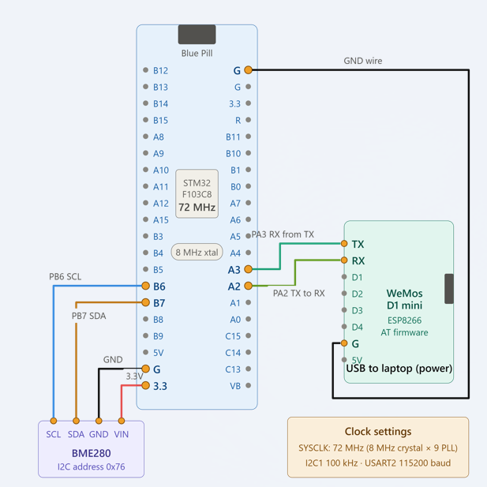

# Mini Project

# BME280-Based Environmental Monitoring Using MQTT and Node-RED

## EXPERIMENT DETAILS

- **Experiment:** Continuous Assessment 15 (CAT 15)
- **Date:**
- **Name of Experiment:** BME280-Based Environmental Monitoring Using MQTT and Node-RED
- **Hardware Setup / Platform:** STM32 Blue Pill (STM32F103C8T6), BME280 Sensor, ESP8266 Wi-Fi Module, Node-RED, EMQX MQTT Broker, OpenWeatherMap API, STM32CubeIDE / Keil MDK

---
### 1. Circuit Diagram

The STM32 Blue Pill communicates with the BME280 sensor through I2C1 and with the ESP8266 through USART2. The ESP8266 connects to Wi-Fi and publishes sensor readings to the EMQX MQTT broker. Node-RED receives the readings and displays them on a live dashboard.

**Hardware Connections:**

**BME280 to STM32 Blue Pill (I2C1)**

| BME280 | STM32 Blue Pill |
|---|---|
| VCC | 3.3V |
| GND | GND |
| SCL | PB6 (I2C1 SCL) |
| SDA | PB7 (I2C1 SDA) |

**ESP8266 to STM32 Blue Pill (USART2)**

| ESP8266 | STM32 Blue Pill |
|---|---|
| TX | PA3 (USART2 RX) |
| RX | PA2 (USART2 TX) |
| GND | GND |

**Circuit Diagram:**



---

### 2. Core Logic / Pseudocode / Code Base

**Working Principle:**

1. Initialize the STM32 system clock, GPIO, I2C1 and USART2.
2. Initialize the BME280 sensor and configure temperature, pressure and humidity oversampling.
3. Initialize the ESP8266 in station mode and connect to Wi-Fi.
4. Establish a TCP connection with the EMQX MQTT broker.
5. Configure the MQTT client and connect to the broker.
6. Read temperature, pressure and humidity from the BME280.
7. Convert pressure from Pa to hPa by dividing by 100.
8. Format the readings into a JSON payload using `snprintf()`.
9. Publish the payload to the MQTT topic `stm32/bme280/data` using QoS 0.
10. Repeat the process every two seconds.
11. Node-RED subscribes to the MQTT topic, parses the JSON data and displays the sensor readings.
12. OpenWeatherMap provides real-time weather data for Chennai, including temperature, pressure, humidity and wind speed.
13. Node-RED compares the BME280 and OpenWeatherMap readings and evaluates weather suitability for an Athletic Meet.
14. Display the environmental parameters and final recommendation on the dashboard.

**Pseudocode:**

1. Initialize HAL, system clock, GPIO, I2C1 and USART2.
2. Initialize and configure the BME280 sensor.
3. Initialize ESP8266 and connect to Wi-Fi.
4. Connect to the MQTT broker.
5. Continuously read BME280 sensor values.
6. Convert pressure into hPa and prepare the JSON payload.
7. Publish sensor data to the MQTT topic.
8. Wait for two seconds and repeat.
9. In Node-RED, subscribe to the MQTT topic and parse the JSON payload.
10. Retrieve Chennai weather information from OpenWeatherMap.
11. Compare temperature, pressure and humidity; consider wind speed.
12. Generate the Athletic Meet weather suitability recommendation.
13. Display all readings and the recommendation on the dashboard.

**Functions / Constructs Used:**

| Function / Construct | Description |
|---|---|
| `HAL_Init()` | Initializes the STM32 HAL library. |
| `SystemClock_Config()` | Configures the system clock. |
| `MX_I2C1_Init()` | Initializes I2C1 communication. |
| `MX_USART2_UART_Init()` | Initializes USART2 communication. |
| `user_i2c_read()` | Reads BME280 registers using `HAL_I2C_Mem_Read()`. |
| `user_i2c_write()` | Writes BME280 registers using `HAL_I2C_Mem_Write()`. |
| `user_delay_us()` | Provides microsecond delay for the BME280 driver. |
| `bme280_init()` | Initializes the BME280 sensor. |
| `bme280_set_sensor_settings()` | Configures sensor oversampling and filter settings. |
| `bme280_set_sensor_mode()` | Sets the sensor operating mode. |
| `ESP8266_Init()` | Initializes the ESP8266 module. |
| `ESP8266_wifiConnect()` | Connects ESP8266 to Wi-Fi. |
| `ESP8266_portConnect()` | Establishes TCP connection with the MQTT broker. |
| `MQTT_connectBroker()` | Establishes MQTT connection. |
| `bme280_get_sensor_data()` | Reads temperature, pressure and humidity. |
| `snprintf()` | Formats sensor readings into JSON. |
| `MQTT_publishTopic()` | Publishes data to the MQTT topic. |
| `HAL_Delay()` | Provides a two-second publishing interval. |

---

### 3. MQTT Configuration

| Parameter | Value |
|---|---|
| Broker | `broker.emqx.io` |
| Port | `1883` |
| Client ID | `stm32_publisher` |
| Topic | `stm32/bme280/data` |
| QoS | 0 |
| Publishing Interval | 2 seconds |

**Sample JSON Payload:**

```json
{
    "temperature": 28.45,
    "pressure": 1008.32,
    "humidity": 65.21
}
```
---

### 4. Node-RED Implementation

Node-RED receives sensor data through MQTT and retrieves external weather information using the OpenWeatherMap API.

**Node-RED Flow:**

```text
MQTT In ──> JSON ──> Function ──> Dashboard Gauges
                             
OpenWeatherMap ──> Function ──> Weather Comparison
                                      |
                                      v
                              Suitability Output
                                      |
                                      v
                              Dashboard Display
```

**Node Configuration:**

| Node | Function |
|---|---|
| MQTT In | Subscribes to `stm32/bme280/data`. |
| JSON | Converts incoming JSON into an object. |
| Function | Extracts temperature, pressure and humidity. |
| OpenWeatherMap | Retrieves Chennai weather information. |
| Function | Compares environmental parameters and determines suitability. |
| Dashboard Gauges | Displays live sensor and weather readings. |
| Dashboard Display | Shows the final recommendation. |

---

### 5. Mini-Project – Athletic Meet Weather Suitability Prediction

The experiment was extended into a mini-project to determine whether the prevailing weather conditions in Chennai are suitable for conducting an Athletic Meet.

**Working Principle:**

- BME280 measures local temperature, atmospheric pressure and humidity.
- STM32 publishes the readings to EMQX through ESP8266 using MQTT.
- Node-RED retrieves Chennai's temperature, pressure, humidity and wind speed from OpenWeatherMap.
- BME280 and OpenWeatherMap temperature, pressure and humidity readings are compared.
- OpenWeatherMap wind speed is also considered during weather evaluation.
- Node-RED processes these parameters using predefined decision criteria to generate an Athletic Meet suitability recommendation.

**Parameters Monitored:**

| Parameter | Data Source |
|---|---|
| Temperature | BME280 and OpenWeatherMap |
| Atmospheric Pressure | BME280 and OpenWeatherMap |
| Humidity | BME280 and OpenWeatherMap |
| Wind Speed | OpenWeatherMap |
| Weather Suitability | Node-RED decision logic |

**Dashboard Output:**

- BME280 temperature, pressure and humidity.
- OpenWeatherMap temperature, pressure, humidity and wind speed.
- Comparison of local and external weather readings.
- Final Athletic Meet suitability recommendation.

---

### 6. Inference

The experiment demonstrates an IoT-based environmental monitoring system using STM32, BME280 and ESP8266. Sensor readings are transmitted to the EMQX MQTT broker and visualized through Node-RED.

The system was further extended into an Athletic Meet Weather Suitability Prediction mini-project. It compares BME280 temperature, pressure and humidity with Chennai weather data from OpenWeatherMap and also considers wind speed. Node-RED processes these parameters to generate a weather suitability recommendation.

Thus, the project demonstrates I2C and UART communication, sensor interfacing, Wi-Fi connectivity, MQTT communication, API integration, real-time monitoring and IoT-based decision-making.
